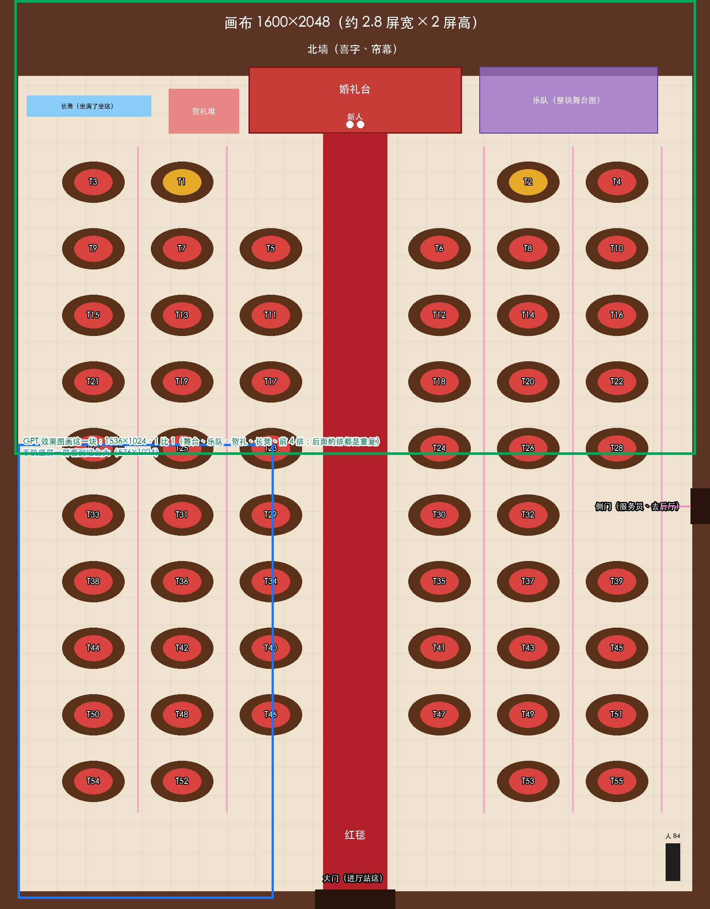

# 宴会厅 55 桌 · 方案（02，9/24 晚）

> 01 派：阿鱼 9/24 定，宴会厅照婚礼当天 55 桌、一个大厅摆下。先摸底、出方案，不写正式代码。
> 之前那套 12 桌的底图和摆位（`001-宴会厅/交接/claude-宴会厅底图-现用.png`、`claude-宴会厅摆位图-v1.png`、`claude-宴会厅摆位-v1.json`）作废，文件先留着不删，别再拿去用。
> 这回新写了三个文件，都不是正式代码：排法草图脚本 `tools/plan_hall55.py`、帧率试验 `tools/perf_hall55.gd`，草图本身是 `回执/宴会厅55桌-排法草图.png`。

## 结论（先看这段）

- **画布 1600×2048**，手机上约 2.8 屏宽、2 屏高（现在的厅是 1536×1024，约 2.7 屏宽、1 屏高）。左右各 3 列、10 行，空 5 个位，正好 55 桌，红毯留在正中
- **地面铺瓦片，桌子做一块积木摆 55 遍**，不再画一整张底图。现在那张底图里的桌子比比例尺大 1.36 倍，不拿来拼新厅
- **电脑上撑得住**：55 桌、330 个 NPC 全开，平均每秒 517～551 帧，宾客动作的脚本每帧 0.6 毫秒。**手机要真机试**：小程序里跑的是网页版，会比电脑慢很多，估计还够用，但没量过，写「待验证」
- **服务端只改两个配置**（桌数、桌号表）就能分 550 个座。有一处要先定：**现在还有空椅子时就会把人送去坐长凳**，55 桌时照样会发生（见第 4 节）
- **GPT 效果图画 1536×1024**，1 比 1，只画厅的前半截（舞台、乐队、贺礼、长凳、前 4 排）。后面的排都是重复的，画那一块就能拆出全部积木

## 1. 画布和排法

照「人 = 1」比例尺排（ASSETS 第 15 节：左右 1 米 = 48 像素，前后 1 米 = 32 像素）：

| 东西 | 真实大小 | 画布上 |
| --- | --- | --- |
| 一桌连椅子和坐着的人占的地 | 桌面 1.8 米，外面一圈椅子和人 0.55 米 | 140×92 |
| 桌与桌左右间距 | 中间留 1.3 米过道，人走得过去 | 200 |
| 桌与桌前后间距 | 中间留 1.8 米，后一排坐着的人头不压前一排 | 150 |
| 红毯 | 3 米宽，两边再各空 1 米 | 144 |
| 婚礼台 | 宽 10 米 | 480×150 |
| 乐队 | 沿用现在那整块舞台图 | 402×164 |

- **排法**：左右各 3 列（列心 x 210、410、610 | 990、1190、1390），10 排（第 1 排 y 410，往下每排 150），一共 60 个位，空 5 个：
  - **第 1 排中间 2 个**：新人下台敬酒从这儿走，也不挡婚礼台
  - **最后一排中间 2 个**：进门
  - **东墙侧门口 1 个**：服务员进出、去后厅
- **桌号**照服务端「桌号表的顺序就是排桌的顺序」：从前排往后，每排先中间后两边、先左后右。T1、T2 是离婚礼台最近的两桌，阿鱼、Toretto 的枝坐这两桌（和现在一样）
- **其他东西**：婚礼台和新人在北墙正中；乐队在婚礼台右边；贺礼堆在婚礼台左边；长凳靠西北墙根；大门在南墙正中；侧门在东墙第 6 排那里
- **走路要多久**：现在从大门走到婚礼台约 4 秒，新厅约 11 秒（走路速度每秒 3.2 米）。要不要进厅就站在自己那桌边上，是玩法上的事，**待 01 / 阿鱼定**

## 2. 地面和桌子改用瓦片和积木

现在的做法是：一整张底图（桌椅、灯、花都画在上面），再把桌子那一块抠出来盖在人上面挡人。55 桌如果还画整张底图，画布大 2 倍、包也大，而且 55 张桌要长得一模一样，整张画做不到。改成：

| 层 | 做法 | 要 GPT 出什么 |
| --- | --- | --- |
| 地面 | 64×64 的瓦片铺满，引擎里一张图重复贴（试验里就是这么铺的，不费事） | 地砖瓦片 1～2 种（能无缝拼） |
| 红毯 | 横 144 宽的一段，竖着重复贴 | 红毯一段（上下能接） |
| 墙 | 北墙一整条（喜字、帘幕、窗），东西两边墙一段一段接 | 北墙整条 1600 宽；侧墙一段（上下能接）；大门、侧门 |
| 桌子 | 一张桌连 10 把椅子做一块积木，摆 55 遍；挡人照现在的办法按着地点排前后 | 桌子积木 1 块（桌面 86 宽） |
| 婚礼台、乐队、贺礼、长凳、灯、花 | 各一块积木，按位置摆 | 婚礼台 1、贺礼 1、长凳 1、落地灯 1、花盆 1（乐队沿用） |

- **能走的格子**：不再手描，由排桌的脚本按每张桌的占地自动算（格子 10 像素，160×205 格；寻路照现在的办法）
- **镜头**：现在只左右跟人（画布只有一屏高），要加上下跟人，到四边停住。一屏看 1024 高不变，人在手机上的大小不变
- **怎么过渡**：新厅做成一个新场景，和现在的 12 桌厅并存，开关切换；新厅没验收前，玩家玩的照旧是 12 桌厅。GPT 的正式图没到之前，新厅全部用色块占位（桌子、墙、台子都是色块），先把排法、走路、分座跑通
- **现在那张底图**：不再用。里面的桌子比比例尺大 1.36 倍（03 量的），栏杆、侧门、灯柱杆也要重画，不拿来拼新厅
- **上线顺序**：先上手机这头（新厅能摆 55 桌，服务端还是 12 桌时后面的桌子空着，不出错），再改服务端配置。反过来会出问题：手机这头遇到画面上没摆的桌号，那桌的人**直接不画**

## 3. 手机撑不撑得住

**试验**（`tools/perf_hall55.gd`）：色块占位，结构和现在的宴会厅一样。
- 画面：地面瓦片一张图铺满；每桌一块桌子积木；每个 NPC 一个上半身，共用一张图；4 个服务员来回走
- 每帧动作和现在的宾客一样：吃一口低头、转头、举杯
- 镜头绕全厅走一圈；手机竖屏 540×960，不锁帧，在这台 Mac 上开窗口跑

| 情形 | 平均帧率 | 最低帧率 | 最慢 1% 的帧 | 宾客脚本每帧 | 画图调用 | 节点 |
| --- | --- | --- | --- | --- | --- | --- |
| 12 桌 × 8 人 = 96（和现在差不多） | 848～853 | 221～678 | 1.4～2.4 毫秒 | 0.18 毫秒 | 16～35 | 309 |
| **55 桌 × 6 人 = 330** | **517～551** | 336～489 | 2.1～2.4 毫秒 | **0.61 毫秒** | 43～46 | 1054 |
| 55 桌 × 6 人，宾客不动 | 1001 | 916 | 2.1 毫秒 | 0 | 16 | 1054 |
| 55 桌 × 10 人 = 550（坐满） | 411 | 387 | 3.0 毫秒 | 1.03 毫秒 | 65 | 1714 |

- 看得出：**55 桌比 12 桌慢一点五倍左右，主要慢在每帧给三百多个宾客算动作**。镜头外的桌子引擎自己不画，画面这头不是问题。搭整个厅（上千个节点）19 毫秒
- 画图调用会从 16 涨到 46，是因为举杯时的酒杯是另一张图。把酒杯并进宾客那张图就能压回去
- **手机上多慢，待验证**：小程序里跑的是网页版，脚本比电脑上慢很多（我估 10～20 倍，没量过）。照这个估，宾客动作每帧要 6～12 毫秒，一帧总共只有 16.7 毫秒（每秒 60 帧），会吃紧
- **要真机试**。建议出一个试验码：进宴会厅就是 55 桌满厅的色块版，屏上显示帧率，阿鱼拿手机走一圈，报个数。出不出这个码、什么时候出，01 定
- **撑不住的办法**，按先后，桌子照样 55 张：
  1. 只给镜头里看得见的宾客算动作，镜头外的停着（一屏大约 8～10 桌、50～60 人，工作量降到五分之一）
  2. 宾客的动作分几批轮流算，不用每帧每个人都算
  3. 还不够，每桌 NPC 从 5～7 个降到 3～4 个（约 170～220 人），空椅子留给真人坐

## 4. 服务端

子窗口只读查过一遍，结果如下：

- **只改两个配置**：`config.js` 的 `BANQUET_TABLE_COUNT`（其实没有代码读它）和 `BANQUET_TABLE_IDS` 从 T1～T12 扩到 T1～T55，同步进云函数（`sync-cf-rules.js`）、重新部署 enterHall。550 座不用改表结构，一个人一行照旧
- **长凳门槛，要先定**：现在不是全厅坐满才去长凳，逻辑是：
  - 有邀请人的新客，先坐邀请人那一桌
  - 满了就坐这一枝已经开的、还有空位的桌
  - 都没有，就开一张完全没人坐的新桌
  - 这些都找不到，就去长凳，**哪怕别的桌还有空椅子**
  - 55 桌里普通桌 53 张，所以最多只能开 53 枝，第 54 枝的人就直接上长凳
  - 要不要改成「普通桌全满了才去长凳」（开不了新桌就插到有空位的桌），是玩法上的事，**待 01 / 阿鱼定**；改的话动 `banquet.js` 的 `assignSeat` 一处
  - 另外，没有邀请人的人会先坐进 T1、T2（保留桌），这是现在就有的小毛病，55 桌时一并改
- **换桌**：不查桌号在不在表里、椅子号是不是 1～10，55 桌时要补上（`changeSeat`），不然传个 T99 也能写进去
- **进厅先见人**：「谁来过、谁写了」那张卡本身和桌数无关。但每次进厅，服务端要翻几遍数据：
  - 要做的事：全厅座位读两遍（每页 100 条，550 人各 6 页），翻「谁来过」，再分批查昵称
  - 一共 20 多次来回
  - 云函数默认超时我记得是 3 秒，**待验证**；手机这头等 12 秒
  - 建议先试 550 人的假数据，看进厅要多久，要么调高超时，要么把两遍合成一遍
- **分座的连锁**：
  - 每桌的「分枝」按这桌 `_id` 排第一的人的邀请人算，不是最早坐下的人，有人换桌后可能变。桌多了这种情况更常见，建议改成按最早坐下的
  - 注释里写的「120 个座」要跟着改（不影响运行）
- **手机这头跟着改的**（写代码时一起做）：
  - 椅子一圈 10 把写死在两处
  - NPC 每桌几个的表（`ambience.json`，脚本生成）
  - 电脑上的假数据只回 12 桌
  - 长凳的提示「120 个座坐满」
  - 测试里断言 120 座、12 桌的几处
- 小游戏：已经搬去迎宾院，和桌号脱钩了，不受影响

## 5. 还原：GPT 效果图怎么画才拆得回来

- **画多大**：**1536×1024，1 比 1**（人 84 像素高），只画厅的前半截：x 32～1568、y 0～1024，草图上绿框那一块
  - 这块里有北墙、婚礼台、新人、乐队、贺礼、长凳、红毯、左右 6 列、前 4 排桌子
  - 后面几排都是同一块桌子积木重复摆，不用画
  - 1536×1024 正好是 GPT 出图的尺寸，不用缩放
- **照什么摆**：我们给 GPT 一张**摆位底板**，GPT 在这张底板上画，5 张都用同一张：
  - 1536×1024，按 64 格画出地砖线
  - 每张桌、每样东西的位置用灰框标好，框的大小就是积木的大小
  - 站 3 个 84 像素的人当尺子
  - 另附一份坐标 json
  - 位置和大小都不许动，GPT 只管画风
- **拆的时候**：阿鱼 5 选 1 以后，GPT 在造景台里照同一张底板把每样东西重画成透明底的积木，另外交地砖、红毯、墙的瓦片。每块的着地点照 json 写，02 照 json 放回游戏，摆出来和效果图一样
- **底板现在不出**：排法（第 1 节）01 / 阿鱼点头后，02 再照定下的排法导出底板和 json。和之前 12 桌那套一样，从排桌脚本里直接导，不另外排

## 要 01 / 阿鱼定的（都是方向）

1. 排法照草图行不行（左右各 3 列 × 10 排，空 5 个位）
2. 进厅站大门口（走到婚礼台约 11 秒），还是直接站在自己桌边
3. 长凳门槛：照旧（开不了新桌就去长凳），还是改成全厅普通桌坐满了才去
4. 出不出真机试验码（55 桌满厅色块版，屏上显示帧率）
