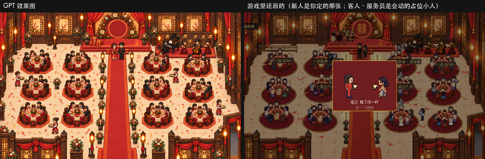

# 宴会厅照 GPT 效果图还原 · 回执（02，9/24 晚）

阿鱼 9/24 晚直接要的：「把 gpt 的图还原回去，但是不要 gpt 的新人，新人得用我制定的」。

**用了什么**
- GPT 21:30 交的 A04 积木（`001-宴会厅/积木/`）：空地面底图 `base.png`（4ec996d5…）、桌子 `blk_table_round.png`（d1450b01…）、落地灯 `blk_lantern_floor.png`（15f241d5…）。没有配套交接单（`交接/handoff_scene_roman_banquet_a04_pilot.json` 还没交），sha 是落地时我记的，21:30 以后没再变
- 花盆沿用旧积木；前景栏杆照旧积木的形状，从新底图上重剪
- 新人：**阿鱼定的那张合照**（`assets/couple.png`），站在舞台台阶下红毯上，位置照效果图
- 客人、服务员、礼物堆、桌下地毯、彩带：还是游戏里会动的占位（GPT 的正式宾客、服务员、摆设包还没交）

**摆法**
- 12 张桌的桌心，对着效果图逐张量的（桌子积木叠上去对齐）；桌号照旧「离舞台近、离红毯近的先编」
- 红毯两边：一边 3 盏落地灯、4 盆花，照效果图的节奏；墙边那 4 盏落地灯效果图里没有，撤了
- 礼物堆挪到舞台左边台面上（照效果图）
- 能走的范围：顶上一排桌子的后排椅子到了 y 280 上下，能走的往北扩到 y 270；舞台正前方（新人站的地方）照旧从 y 320 起；乐队底下从 y 300 起（乐队整块舞台开场时会挖掉格子）

**查验**
- 硬检查：尺寸对，透明底干净（紫、绿、米色三种底上看过），半透明只在影子上
- 比例：桌面约 103 宽（表里 86，1.2 倍），椅子约 36 高（表里 46，0.8 倍），落地灯 67 高（表里 77～86，0.9 倍），都在范围里
- 效果图里红毯画宽了、灯画成一个人高，和积木不一样；照积木的尺寸摆，位置照效果图
- 测试：客户端 27 个全过。改了的测试：`test_backhall` 能走格子数 5081+19 → 5369（布局变了）；`test_remote_probe` 的假下载改从 `tools/fixtures/remote_probe_base.png`（云上那张旧底图的拷贝，tools 不进包）拷

**重做的办法**：`python3 godot/tools/build_layered.py godot/tools/layout_v11_effect/scene_effect.json`，再 `python3 godot/tools/make_ambience_layout.py`
