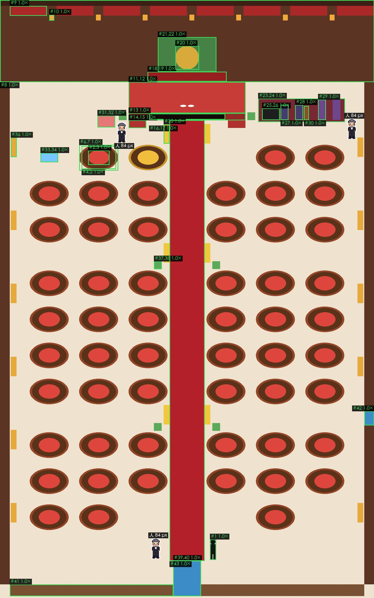
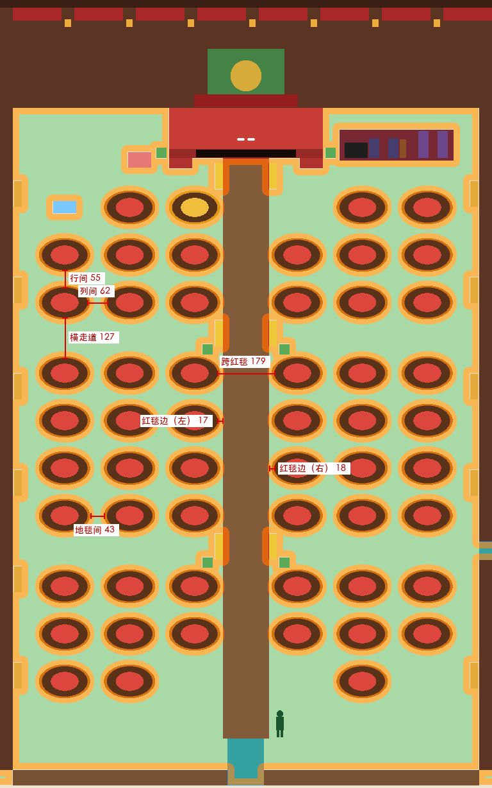
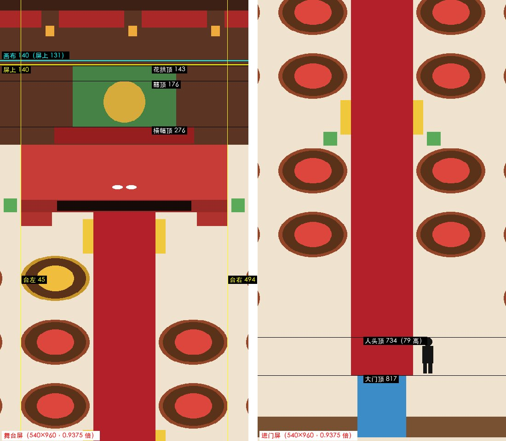

# 比例量尺 · 55 桌摆位底图 v2（03，2026-09-25）

> 01 D 派的：量 02 用色块排的 55 桌摆位底图 v2（36c76bb）——比例、摆位表对图、走道、手机屏两张。量的是 `宴会厅55桌-摆位底图.png`（干净版，1536×2454，一共 32 种纯色、没有抗锯齿）：**每件东西按颜色从图上切出来量，不是抄 02 的摆位表**；摆位表只在第二节拿来和图对。不改 02 的文件，不下「能不能用」的结论（那是 01 的）。
> 这几个文件从 36c76bb 到 c264861（加 `--north` 切北边那块）没有改过，结论对最新的 main 也成立。

## 结论

**比例没有一件超标（43 项：绿 43、红 0）；摆位表 180 件和图对上了，3 件差超过 2 像素（都不是画错）；走道没有一条窄过一人宽 43；手机屏两张都过。** 但有一条要 01 看的风险（第五节第 1 条）：色块是地上占地，不是图的外框，GPT 画出来的桌子外框会比色块高约 40～65、宽约 20～25，行距 148、列距 203 可能放不下。

| 验收标准 | 结果 |
| --- | --- |
| 偏差表里标红的（大过 1.5 倍、小过一半）一件件列出来 | **没有**（43 项全绿） |
| 表和图差超过 2 像素的列出来 | **3 件**：挂灯 8（表里有、图上没有——在画布外）；花拱高（表里 180、图上只露出 142，下面 38 被横幅盖住）；尺子人（图上的人宽 25、表里 32，x 也差 4）。另有 58 件宽高多 1 像素，是画椭圆含终点，不算差 |
| 走道窄过一人宽（43）的列出来 | **没有**：最窄的走道是行间 55、列间 62；人宽 43 的圆从进门空地出发，55 张桌都走得到，路上最窄一段 60。窄过 43 的只有死角（红毯边到桌 17／18 等，不是走道，见第三节） |
| 手机屏两张 | **过**：囍、横幅、花拱都在顶上 140 那条下面（花拱顶只差 3 像素）；舞台那屏台子整个在屏里，左右各留 45 |

## 一、比例（对 ASSETS §15）

**人（尺子）**

| # | 东西 | 测得 px | 表里 px | 超出表里范围几倍 | 判定 | 来源 | 结论 |
| --- | --- | --- | --- | --- | --- | --- | --- |
| 1 | 人（进门空地上那个）高 | 84（1.00 人） | 84（1.00 人） | 1.0× | 绿 | 干净版上的人 | 对 |

**桌和地毯（54 张普通桌 + 主桌，同一个样，量 T1）**

| # | 东西 | 测得 px | 表里 px | 超出表里范围几倍 | 判定 | 来源 | 结论 |
| --- | --- | --- | --- | --- | --- | --- | --- |
| 2 | 桌面（里面红的那块）宽 | 87（1.04 人） | 86（1.02 人） | 1.0× | 绿 | 02 色块（摆位底图 v2） | 对 |
| 3 | 桌面 前后 | 59（0.70 人） | 58（0.69 人） | 1.0× | 绿 | 02 色块（摆位底图 v2） | 对 |
| 4 | 桌加椅子一圈 宽 | 141（1.68 人） | 134.4～163.2（1.60～1.94 人；估 2.8～3.4 米） | 1.0× | 绿 | 02 色块（摆位底图 v2） | 对（估） |
| 5 | 桌加椅子一圈 前后 | 93（1.11 人） | 89.6～108.8（1.07～1.30 人；估 2.8～3.4 米） | 1.0× | 绿 | 02 色块（摆位底图 v2） | 对（估） |
| 6 | 地毯 宽 | 160（1.90 人） | 153.6～192（1.83～2.29 人；估 3.2～4 米） | 1.0× | 绿 | 02 色块（摆位底图 v2） | 对（估） |
| 7 | 地毯 前后 | 105（1.25 人） | 102.4～128（1.22～1.52 人；估 3.2～4 米） | 1.0× | 绿 | 02 色块（摆位底图 v2） | 对（估） |

**北墙、婚礼台、台阶、LED、横幅、囍、花拱**

| # | 东西 | 测得 px | 表里 px | 超出表里范围几倍 | 判定 | 来源 | 结论 |
| --- | --- | --- | --- | --- | --- | --- | --- |
| 8 | 北墙 高 | 336（4.00 人） | 240～384（2.86～4.57 人；估 5～8 米） | 1.0× | 绿 | 02 色块（摆位底图 v2） | 对（估） |
| 9 | 帐幔 垂下的高 | 40（0.48 人） | 28.8～48（0.34～0.57 人；估 0.6～1 米） | 1.0× | 绿 | 02 色块（摆位底图 v2） | 对（估） |
| 10 | 挂灯 高 | 24（0.29 人） | 19～24（0.23～0.29 人） | 1.0× | 绿 | 02 色块（摆位底图 v2） | 对 |
| 11 | 婚礼台 台面 宽 | 480（5.71 人） | 288～672（3.43～8.00 人；估 6～14 米） | 1.0× | 绿 | 02 色块（摆位底图 v2） | 对（估） |
| 12 | 婚礼台 台面 前后 | 128（1.52 人） | 76.8～160（0.91～1.90 人；估 2.4～5 米） | 1.0× | 绿 | 02 色块（摆位底图 v2） | 对（估） |
| 13 | 婚礼台 台口立面 高 | 29（0.35 人） | 14.4～38.4（0.17～0.46 人；估 0.3～0.8 米） | 1.0× | 绿 | 02 色块（摆位底图 v2） | 对（估） |
| 14 | 台阶 宽（一段） | 72（0.86 人） | 57.6～115.2（0.69～1.37 人；估 1.2～2.4 米） | 1.0× | 绿 | 02 色块（摆位底图 v2） | 对（估） |
| 15 | 台阶 前后（一段） | 32（0.38 人） | 19.2～38.4（0.23～0.46 人；估 0.6～1.2 米） | 1.0× | 绿 | 02 色块（摆位底图 v2） | 对（估） |
| 16 | LED 屏 宽 | 312（3.71 人） | 192～480（2.29～5.71 人；估 4～10 米） | 1.0× | 绿 | 02 色块（摆位底图 v2） | 对（估） |
| 17 | LED 屏 高 | 24（0.29 人） | 14.4～38.4（0.17～0.46 人；估 0.3～0.8 米） | 1.0× | 绿 | 02 色块（摆位底图 v2） | 对（估） |
| 18 | 横幅 宽 | 324（3.86 人） | 192～384（2.29～4.57 人；估 4～8 米） | 1.0× | 绿 | 02 色块（摆位底图 v2） | 对（估） |
| 19 | 横幅 高 | 40（0.48 人） | 28.8～57.6（0.34～0.69 人；估 0.6～1.2 米） | 1.0× | 绿 | 02 色块（摆位底图 v2） | 对（估） |
| 20 | 囍字圆牌 直径 | 97（1.15 人） | 72～120（0.86～1.43 人；估 1.5～2.5 米） | 1.0× | 绿 | 02 色块（摆位底图 v2） | 对（估） |
| 21 | 花拱 宽 | 240（2.86 人） | 144～288（1.71～3.43 人；估 3～6 米） | 1.0× | 绿 | 02 色块（摆位底图 v2） | 对（估） |
| 22 | 花拱 高（下面被横幅盖住，只量到露出的） | ≥142（≥1.69 人） | 120～192（1.43～2.29 人；估 2.5～4 米） | ≥1.0× | 绿 | 02 色块（摆位底图 v2） | 对（估）；下半截被横幅盖住，量不到 |

**乐队（乐队地台上）**

| # | 东西 | 测得 px | 表里 px | 超出表里范围几倍 | 判定 | 来源 | 结论 |
| --- | --- | --- | --- | --- | --- | --- | --- |
| 23 | 乐队地台 宽 | 356（4.24 人） | 288～432（3.43～5.14 人；估 6～9 米） | 1.0× | 绿 | 02 色块（摆位底图 v2） | 对（估） |
| 24 | 乐队地台 前后 | 96（1.14 人） | 80～128（0.95～1.52 人；估 2.5～4 米） | 1.0× | 绿 | 02 色块（摆位底图 v2） | 对（估） |
| 25 | 三角钢琴 长 | 72（0.86 人） | 72（0.86 人） | 1.0× | 绿 | 02 色块（摆位底图 v2） | 对 |
| 26 | 三角钢琴 琴身高 | 48（0.57 人） | 48（0.57 人） | 1.0× | 绿 | 02 色块（摆位底图 v2） | 对 |
| 27 | 钢琴手（坐）高 | 62（0.74 人） | 62（0.74 人） | 1.0× | 绿 | 02 色块（摆位底图 v2） | 对 |
| 28 | 大提琴手（坐）高 | 62（0.74 人） | 62（0.74 人） | 1.0× | 绿 | 02 色块（摆位底图 v2） | 对 |
| 29 | 小提琴手（站）高 | 84（1.00 人） | 84（1.00 人） | 1.0× | 绿 | 02 色块（摆位底图 v2） | 对 |
| 30 | 大提琴 高 | 58（0.69 人） | 52.8～62.4（0.63～0.74 人；估 1.1～1.3 米） | 1.0× | 绿 | 02 色块（摆位底图 v2） | 对（估） |

**摆设**

| # | 东西 | 测得 px | 表里 px | 超出表里范围几倍 | 判定 | 来源 | 结论 |
| --- | --- | --- | --- | --- | --- | --- | --- |
| 31 | 礼物堆 高 | 48（0.57 人） | 48（0.57 人） | 1.0× | 绿 | 02 色块（摆位底图 v2） | 对 |
| 32 | 礼物堆 宽 | 72（0.86 人） | 72～96（0.86～1.14 人；估 1.5～2 米） | 1.0× | 绿 | 02 色块（摆位底图 v2） | 对（估） |
| 33 | 长凳 宽 | 72（0.86 人） | 72（0.86 人） | 1.0× | 绿 | 02 色块（摆位底图 v2） | 对 |
| 34 | 长凳 高 | 38（0.45 人） | 38（0.45 人） | 1.0× | 绿 | 02 色块（摆位底图 v2） | 对 |
| 35 | 落地宫灯 高（红毯边） | 80（0.95 人） | 77～86（0.92～1.02 人） | 1.0× | 绿 | 02 色块（摆位底图 v2） | 对 |
| 36 | 壁边灯柱 高（贴墙） | 80（0.95 人） | 77～86（0.92～1.02 人） | 1.0× | 绿 | 02 色块（摆位底图 v2） | 对 |
| 37 | 花盆 高 | 32（0.38 人） | 24～38（0.29～0.45 人） | 1.0× | 绿 | 02 色块（摆位底图 v2） | 对 |
| 38 | 花盆 宽 | 32（0.38 人） | 24～38（0.29～0.45 人） | 1.0× | 绿 | 02 色块（摆位底图 v2） | 对 |

**大门、栏杆、东侧门、红毯**

| # | 东西 | 测得 px | 表里 px | 超出表里范围几倍 | 判定 | 来源 | 结论 |
| --- | --- | --- | --- | --- | --- | --- | --- |
| 39 | 大门 门洞宽 | 114（1.36 人） | 86～115（1.02～1.37 人） | 1.0× | 绿 | 02 色块（摆位底图 v2） | 对（在上沿） |
| 40 | 大门 门洞高 | 145（1.73 人） | 115～145（1.37～1.73 人） | 1.0× | 绿 | 02 色块（摆位底图 v2） | 对（在上沿） |
| 41 | 南边栏杆 高 | 48（0.57 人） | 48（0.57 人） | 1.0× | 绿 | 02 色块（摆位底图 v2） | 对 |
| 42 | 东侧门 门洞宽（沿墙，前后按 32 一米） | 58（0.69 人） | 57.6～76.8（0.69～0.91 人；估 1.8～2.4 米） | 1.0× | 绿 | 02 色块（摆位底图 v2） | 对（估） |
| 43 | 红毯 宽 | 144（1.71 人） | 72～144（0.86～1.71 人；估 1.5～3 米） | 1.0× | 绿 | 02 色块（摆位底图 v2） | 对（估，在上沿） |

红 0 · 黄 0 · 绿 43（共 43 项）

- **怎么量**：图是 32 种纯色，按颜色切成连通块，量每块的外框（含端点，所以椭圆比 02 表里的数多 1 像素：桌面 87、囍 97）。桌、地毯 54 张一个样，量 T1
- **尺子**：ASSETS v1.3 第 15 节的行（人、桌面、椅、书、灯笼、落地宫灯、壁边灯柱、花盆、长凳、钢琴、坐着的人、礼物堆、双开门、栏杆）。**§15 没有的**（婚礼台、台阶、LED、横幅、囍、花拱、北墙、乐队地台、大提琴、红毯、东侧门宽、桌加椅子一圈、地毯）我按真实大小估了一个宽范围，表里标「估」——**只判离不离谱，不判准不准**，范围写在框文件里，改数能复跑
- 贴着上沿的（不超，提一句）：大门宽 114、高 145 都在 §15「双开门」范围的上沿；红毯 144（3 米）在我估的 1.5～3 米的上沿；北墙 336（7 米）在 5～8 米里偏高
- 标图：绿框都在尺内，白边小人是游戏里真的 NPC（84）按 1:1 站在主桌左边、大门左边、乐队地台东边



## 二、摆位表对图

全量：表里 180 件，**175 件能按颜色在图上找到，逐件比了 x／y／宽／高**；另外 5 件没有独立颜色（北墙、西墙、东墙北段、东墙南段、进门站的地方），我从图上按像素扫了一遍（北墙 336、墙厚 40、西墙高 2062、东墙北段 1351、东墙南段 653、东侧门 1687～1744，进门站的那块 300×96 里只有地面、红毯和尺子人）。结果：

- **114 件一模一样**；**58 件宽、高多 1 像素**（54 张桌一圈 + 主桌 + 囍 + 两个新人脚印，都是椭圆，画法含终点）
- **差超过 2 像素的 3 件**：

| 东西 | 摆位表 x／y／宽／高 | 图上量到 x／y／宽／高 | 差 | 是怎么回事 |
| --- | --- | --- | --- | --- |
| 挂灯 8 | 1546／60／20／24 | 图上没有 | — | x 1546 已经出了画布（宽 1536）。8 段帐幔中间只有 7 条缝，该有 7 盏；表里多了一行，图是对的 |
| 花拱 | 648／152／240／180 | 648／152／240／**142** | 高 −38 | 花拱下面 38 像素被横幅（294～333）盖住，图上量不到；不是画错。GPT 画的时候要说清横幅在花拱前面 |
| 尺子：人 | 858／2213／32／84 | **862**／2213／**25**／84 | x +4、宽 −7 | 人高对（84），身子画得比表里的框窄，居中 |

抽样 20 件（桌、地毯、台上那几样、门都有），差都在 ±1 以内，只有花拱那一件：

| 东西 | 摆位表 x／y／宽／高 | 图上量到 x／y／宽／高 | 差 |
| --- | --- | --- | --- |
| T1 | 335／600／140／92 | 335／600／141／93 | +0／+0／+1／+1 |
| 主桌 | 538／600／140／92 | 538／600／141／93 | +0／+0／+1／+1 |
| T27 | 1264／1264／140／92 | 1264／1264／141／93 | +0／+0／+1／+1 |
| T54 | 132／2076／140／92 | 132／2076／141／93 | +0／+0／+1／+1 |
| T1 地毯 | 325／594／160／105 | 325／594／160／105 | +0／+0／+0／+0 |
| 主桌 地毯 | 528／594／160／105 | 528／594／160／105 | +0／+0／+0／+0 |
| 婚礼台（台面） | 528／336／480／128 | 528／336／480／128 | +0／+0／+0／+0 |
| 台阶（西） | 528／493／72／32 | 528／493／72／32 | +0／+0／+0／+0 |
| LED 屏 | 612／466／312／24 | 612／466／312／24 | +0／+0／+0／+0 |
| 横幅 | 606／294／324／40 | 606／294／324／40 | +0／+0／+0／+0 |
| 囍字圆牌 | 720／188／96／96 | 720／188／97／97 | +0／+0／+1／+1 |
| 花拱 | 648／152／240／180 | 648／152／240／142 | +0／+0／+0／**−38** |
| 红毯 | 696／493／144／1808 | 696／493／144／1808 | +0／+0／+0／+0 |
| 大门（双开门门洞） | 711／2301／114／145 | 711／2301／114／145 | +0／+0／+0／+0 |
| 东侧门（门洞） | 1496／1687／40／58 | 1496／1687／40／58 | +0／+0／+0／+0 |
| 南边东段栏杆 | 825／2398／671／48 | 825／2398／671／48 | +0／+0／+0／+0 |
| 三角钢琴 | 1076／444／72／48 | 1076／444／72／48 | +0／+0／+0／+0 |
| 乐队地台 | 1060／404／356／96 | 1060／404／356／96 | +0／+0／+0／+0 |
| 贺礼堆 | 400／474／72／48 | 400／474／72／48 | +0／+0／+0／+0 |
| 长凳 | 166／627／72／38 | 166／627／72／38 | +0／+0／+0／+0 |

另外，表里「新人站位」的依据列写「头顶到 y 206」，图上脚印在 y 430～438、人高 84，头顶该在 y 346～354。206 像是 v1（整厅还没往下挪 144）的数，v2 没跟着改——图不受影响，但 GPT 若读这句会把头画到横幅上面去（**待 02 核**）。

## 三、走道

从图上量（桌的外框是含椅子一圈的那个椭圆，地毯是 160×105 的那块；像素折成米：左右 48 像素一米，前后 32 像素一米）：

| 走道 | 最窄处（像素） | 折成米 | 比一人宽 43 |
| --- | --- | --- | --- |
| 行间（同一块里上下两排桌之间） | **55** | 1.72 米 | 宽 12 |
| 列间（同一排左右两张桌之间） | **62** | 1.29 米 | 宽 19 |
| 横走道（第 3、7 排后面，桌到桌） | 127 | 3.97 米 | 宽 |
| 跨红毯（红毯两边最近的两张桌之间） | 179（红毯 144 + 两边露地 17、18） | 3.73 米 | 宽 |
| 桌到墙（西 92／东 91）、到壁边灯柱（西 64／东 63） | 63 | 1.3 米 | 宽 |
| 最后一排桌到南边栏杆 | 229 | 7.2 米 | 宽 |
| 大门洞（两截栏杆之间） | 114 | 2.4 米 | 宽 |
| 东侧门（沿墙，前后按 32 一米） | 58 | 1.8 米 | 宽 |
| 地毯和地毯之间露出的地面（上下、左右） | **43** | 1.34 米（前后）／0.9 米（左右） | **刚好一人宽，没有富余** |
| 红毯边到最近的桌 | **17（左）、18（右）** | 0.35～0.4 米 | **窄**——但这不是走道，旁边就是 144 宽的红毯，人走红毯 |
| 红毯边到最近的地毯 | 8（左右） | 0.2 米 | 地毯本来就能走 |

**走得到**：拿人宽 43 的圆（半径 21.5），从进门那块空地出发，55 张桌里走不到桌边的 **0 张**；每张桌按最好走的那条路，路上最窄的一段：最窄 60 像素（比一人宽 43 多 17）、最宽 68。60 是列间 62 少 2（我把挡路的东西每边多算了 1 像素，偏保守）。

**窄过 43 的**：没有走道。有 12 处道具之间的死角，都是花盆、落地宫灯、贺礼堆、台子挨得近，不在任何一条路上：台阶↔花盆 8（2 处）、婚礼台↔花盆 8（2 处）、花盆↔落地宫灯 8（4 处，横走道里红毯边）、乐队地台↔花盆 12、婚礼台↔落地宫灯 16（2 处）、花盆↔贺礼堆 16。另有红毯边到桌 17／18（上表）。



## 四、手机屏两张

两张都是画布按 0.9375 倍裁下来的（一屏看画布 576×1024）：我把画布对应那块裁下来缩到 540×960 和 02 的截图逐像素比，**不一致 0 个像素**，所以截图是真的、不是另画的。

| 项 | 量到 | 要求 | 结果 |
| --- | --- | --- | --- |
| 花拱顶（舞台屏，屏上） | 143（画布 153） | 在顶上 140 那条下面 | 过，**只差 3 像素** |
| 囍字圆牌顶 | 176（画布 188） | 同上 | 过 |
| 横幅顶 | 276（画布 294） | 同上 | 过 |
| 顶上 140 那条里有什么 | 只有墙、帐幔、墙顶横梁、挂灯 | 没有囍、花拱、横幅 | 过（按屏上 140 和按画布 140＝屏上 131 两种算法都一样） |
| 台子在屏里 | 台面、台口立面、台阶 x 45～494，y 315～491 | 整个在屏里（屏宽 0～539） | 过，左右各留 45 |
| 进门那屏 | 大门 x 217～322、y 817～951；红毯上到顶；人头顶 734（79 高 = 84×0.9375）；整张看得见的桌 6 张、露出一部分的 8 张 | 看得见大门、进门空地、红毯、两边几排桌 | 过 |



## 五、要 01 看的风险 / 顺手看到的（不在派活单里）

1. **色块是地上占地，不是图的外框。** 桌加椅一圈 141×93 是 §15 折出来的占地（1.8 米桌 + 椅子圈）。真桌子画出来带椅背、带坐着的人，外框会比占地大。已有的两个数：12 桌厅那张桌子图（同样按人 84 画，桌加椅、没有人）外框 **162×132**（我第一次量宴会厅时量的）；04 第 47 版测试用的桌子图 **165×159**。放进 55 桌的格子：**行距 148——162×132 的放得下（剩 16），165×159 的放不下（上下两排叠 11 像素）**；**列距 203——162～165 宽的桌子，列间只剩 38～41，比一人宽 43 还窄**。这不违反摆位（占地之间够走），但正是 04 第 47 版说的「上下两排桌子叠在一起」。给 GPT 的任务里要写明：色块是占地，桌子外框可以比色块高约 40～65、宽约 20～25；要是不想叠，行距得加（12 桌厅的行距是 165～175）。**行距怎么定是 01 的事，我只报数**
2. **花拱下半截 38 像素被横幅盖住**（图上露出 142，表里 180）。横幅盖在花拱前面还是后面，GPT 画之前要说清，不然会把花拱下沿画到横幅下面去
3. **地毯之间露地面正好 43**（=一人宽）。地毯本来能走，所以不影响走路；但要是 GPT 把地毯画大一点，地面就只剩窄缝，看着又「连成一片红」
4. **乐队和贺礼堆刚好在舞台那一屏的外面**：乐队地台从 x 1060 起，离屏边 4 像素；贺礼堆到 x 471，离屏边 8 像素。手机上站在台前只看得到台子，看乐队、看礼物要走过去（不是错，是这一屏的样子）
5. **表里两处小错**：挂灯 8（第二节）、新人站位依据里的「头顶到 y 206」（第二节）。都不影响图

## 量不准、不敢说满的地方

- 没有官方行的东西（标「估」的 24 行，另外 19 行用 §15 的官方数）我估的是宽范围，只能说不离谱，不能说准。要变成标准，得 01 定，像宴会厅 12 桌那次一样补进 ASSETS
- 走道用「人宽 43 的圆」，是 02 自检和 01 说的规矩；人在前后方向上其实只有约 0.5 米厚（约 16 像素），按 43 算偏严。列在「窄过 43」里的都是死角，不是这个偏严造成的
- 走得到的检查我把挡路的东西每边多算了 1 像素，最窄 60 是偏保守的数（真实 62）
- 桌子的椭圆按外接框量，行间、列间的 55／62 是椭圆最宽处之间的距离，别处更宽
- 只量了这一版色块（36c76bb）；02 改了数要重量。不是真游戏里的画面，没在手机上看

## 复跑

```
cd godot/回执
python3 ../tools/scale_check.py measure 比例量尺-55桌摆位底图v2-框.json --annot /tmp/标图.jpg --compact          # 第一节，退出码 1 = 有红项
python3 ../tools/board_check.py diff  --png 宴会厅55桌-摆位底图.png --table 宴会厅55桌-摆位表.md                  # 第二节
python3 ../tools/board_check.py walk  --png 宴会厅55桌-摆位底图.png --fig /tmp/走道.jpg                          # 第三节（约 16 秒）
python3 ../tools/board_check.py phone --png 宴会厅55桌-摆位底图.png --door 宴会厅55桌-手机屏-进门.png --stage 宴会厅55桌-手机屏-舞台.png --fig /tmp/手机屏.jpg   # 第四节
```

新增的文件：`godot/tools/board_check.py`（新脚本，`diff`、`walk`、`phone` 三个核对；颜色表是 02 的 make_board55.py 用的色，02 换色了改脚本开头的 COLORS）、框文件、三张图。`scale_check.py` 没动。
