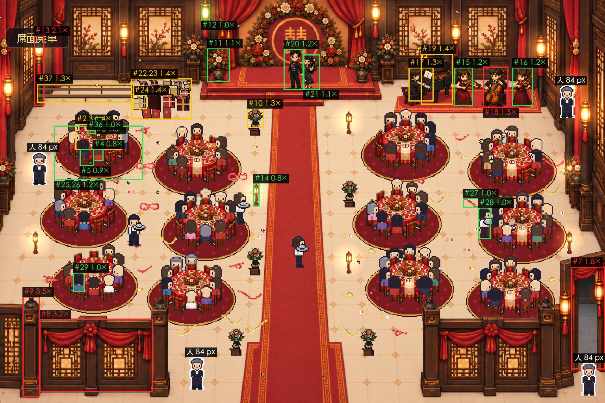

# 比例量尺 · 宴会厅（03，2026-09-24）

> 01 派的：宴会厅收尾清单（`docs/场景收尾-宴会厅.md`）第 4 条。用 `godot/tools/scale_check.py` 量 main 里的宴会厅——底图、乐队、摆设、人物、桌上的东西——对「人 = 1」比例尺（`godot/ASSETS.md` 第 15 节）。量的人不判放不放行，放不放行是 01 判。
> 量的是 89683a1；这期间宴会厅的图和代码（`scene_roman_banquet`、`assets/ambience`、`hall_life.gd`、`layered_hall.gd`、`hall.gd`、`sprites.gd`）没有改动，结论对最新的 main 也成立。
> **v2（同日晚）**：v1（11b3e21）里表里没有的 7 类东西是我估的范围；01 随后把它们补进了 ASSETS v1.2（齐腰栏杆 48、坐着的人 62、三角钢琴琴身 48／长 72、礼物堆高 48、一盘菜 12～14、大插花 48～72、壁边灯柱 77～86，02 同步进了脚本），**这一版按官方的行重算**。v1 是绿 23、黄 8、红 7，v2 是**绿 23、黄 6、红 11**，变化见「v1 到 v3 变了什么」。
> **v3（同日晚，稍后）**：01 又补了「大菜盘（上桌的整盘菜）17～24」（ASSETS v1.3，原来的「一盘菜」改叫「小碟、餐盘」），整盘菜的三行换成它。**v3 是绿 25、黄 6、红 9**。

## 结论

**宴会厅和迎宾院不一样：底图的桌、椅、灯、花，乐队里站着的人都在尺内。要重画的是 4 件（栏杆、东侧门、壁边灯柱的杆、大提琴手——后者缩乐队就行），另有 3 件代码画的占位比例错了（贺礼堆、新上桌的菜里的一张、酒杯），缩小就行。** 量了 40 项：**绿 25、黄 6、红 9**（红的 9 行是 7 件东西：4 件 GPT 的图 5 行，3 件占位 4 行）。

| | 有哪些 |
| --- | --- |
| **对（不用动）** | 底图圆桌（桌面 117 宽×66 深，桌布垂 30）和椅子（高 42、宽 21）；婚礼台两侧大插花（86，官方 48～72，1.19×）；走道的小红灯；壁灯灯身；三角钢琴的长（86 对 72，1.19×）；乐队里站着的两位小提琴手（97、98，是 84 的 1.16 倍）；新郎新娘（104、89）；服务员（80）和坐着的宾客；底图桌上画的餐盘（15 对小碟、餐盘 12～14）和大菜盘（22 对 17～24）；新上桌的菜里的 amb_dish_2、amb_dish_3（30、28 对大菜盘 17～24，1.25×、1.17×）；桌下地毯、地上彩带、托盘、桌心簿子 |
| **黄（偏大 1.3～1.4 倍，先留着）** | 圆桌桌面宽 1.36×、走道花架 1.32×、坐着的钢琴手 1.39×、三角钢琴琴身高 1.29×、一只礼盒 1.42×、长凳高 1.26× |
| **要重画（GPT 的图，红）** | ① **栏杆**：板高 185（2.2 个人高），官方齐腰栏杆 48，3.9×；柱高 255（3 个人高）　② **东侧门**：门洞高 261（3.1 个人），表里 115～145，1.8×　③ **壁边灯柱**：灯身对，杆太长，整根 179（2.1 个人），官方 77～86，2.1×　④ **大提琴手**：坐着 104，官方坐着的人 62，1.7×，比旁边站着的小提琴手（97）还高——**整块乐队舞台缩到 80% 只剩它一个 1.3×（黄），缩到 70% 全进尺**（但那样站着的小提琴手只有 68 像素高），不用重画人 |
| **比例错的代码占位（红）** | ① **贺礼堆**：高 104，官方 48，2.2×（宽 154，估 72～96，1.6×），缩到约 46%　② **新上桌的菜**里的 amb_dish_1：宽 42，官方大菜盘 17～24，1.75×，缩到 24 宽以内（amb_dish_2、amb_dish_3 能留）　③ **酒杯**（amb_cup）：高 12，估该 ≤6，2.1× |
| **代码画的占位（全部，等正式图）** | 贺礼堆、桌下地毯、彩带彩纸、灯笼光、花瓣、菜、托盘、酒杯、蒸汽、桌心簿子、长凳；**服务员和 NPC 宾客**（16×32 放大 2.625 倍的方块人，比例对，但清单要求换成 GPT 画的人物）；乐队备用色块（amb_piano、amb_cello 等，乐队图在时不用，可删） |

对清单第 7 条（厅里的摆设要不要换）的回答：**比例对的摆设（地毯、彩带、托盘、簿子）可以先留着；礼盒偏大 1.4×、长凳 1.26× 也能留；贺礼堆（缩到约 46%）、新上桌的菜里的 amb_dish_1（缩到 24 宽以内，另两张能留）、酒杯（缩到 6 高以内）比例错，改代码里的大小，不用等 GPT。** 人物一定换，是 01 已经定的，和比例无关。



编号对下面表里的 #。白边小人贴在左栏杆右柱旁、东侧门下、乐队右边、左上桌旁：栏杆板比他高一倍多，东侧门门洞比他高 3 倍，大提琴手（红框）坐着，头顶比站着的小提琴手还高。

## 怎么量的

方法同 `比例量尺-样本-迎宾院.md`，这次多三处：

1. **图**：整厅 1:1 截图（1536×1024，1 像素 = 画布 1 像素，不带界面、字牌、弹窗）。截图用的是我在一次性 worktree 里给 main.gd 临时加的预设（不提交），`RES=1536x1024 ./capture.sh 目录 hall_1to1_serve`；底图取自 `git show 89683a1:godot/assets/layered/scene_roman_banquet/base.png`。**跟手机屏没关系，量的是画布**；服务员、宾客、乐队、摆设都是叠在底图上的，所以要量叠好的
2. **尺子**：ASSETS v1.3 第 15 节的行（圆桌、椅子、门、一盆花、落地宫灯、书、人，加 v1.2 的 7 行、v1.3 的大菜盘）；**仍没有官方行的东西（栏杆柱、壁灯灯身、贺礼堆宽、礼盒、托盘、酒杯、地毯、彩带、宾客坐姿）我按真实大小估了范围**，表里标「估」，范围写在框文件里，改数就能复跑。摆设的大小（代码画的）取代码里的真实尺寸（图片文件的不透明外框，位置按 `hall_life.gd` 的锚点）
3. **加了「分节、来源、结论」三样**：工具的 `group`／`src`／`call` 字段和 `--compact` 窄表，一屏东西多时表能看

## 偏差表（脚本 `--compact` 输出，结论列是我按判定写的）

**人（尺子）**

| # | 东西 | 测得 px | 表里 px | 超出表里范围几倍 | 判定 | 来源 | 结论 |
| --- | --- | --- | --- | --- | --- | --- | --- |
| 1 | 人（NPC 一帧，不透明部分）高 | 81（0.97 人） | 84（1.00 人） | 1.0× | 绿 | 游戏里量（NPC 整帧 84） | —（尺子） |

**底图：桌椅**

| # | 东西 | 测得 px | 表里 px | 超出表里范围几倍 | 判定 | 来源 | 结论 |
| --- | --- | --- | --- | --- | --- | --- | --- |
| 2 | 圆桌 桌面宽 | 117（1.39 人） | 86（1.02 人） | 1.4× | 黄·偏大 | GPT 底图（12 张桌同一幅） | 先留着（比表里大三分之一，深度对） |
| 3 | 圆桌 桌面前后（深） | 66（0.79 人） | 58（0.69 人） | 1.1× | 绿 | GPT 底图 | 对 |
| 4 | 圆桌 桌布垂到地的高 | 30（0.36 人） | 36（0.43 人） | 0.8× | 绿 | GPT 底图 | 对 |
| 5 | 椅子 高（含椅背顶） | 42（0.50 人） | 46（0.55 人） | 0.9× | 绿 | GPT 底图 | 对 |
| 6 | 椅子 宽（椅背） | 21（0.25 人） | 22（0.26 人） | 1.0× | 绿 | GPT 底图 | 对 |

**底图：门洞、栏杆**

| # | 东西 | 测得 px | 表里 px | 超出表里范围几倍 | 判定 | 来源 | 结论 |
| --- | --- | --- | --- | --- | --- | --- | --- |
| 7 | 东侧门 门洞高（通后厅） | 261（3.11 人） | 115～145（1.37～1.73 人） | 1.8× | 红·大了 | GPT 底图 | 要重画：门比人高 3 倍 |
| 8 | 栏杆 板高（入口两侧，左右一样） | 185（2.20 人） | 48（0.57 人） | 3.9× | 红·大了 | GPT 底图＋积木 fg_rail | 要重画：比人高一倍多 |
| 9 | 栏杆 柱高（连柱顶的黑帽） | 255（3.04 人） | 57.6～72（0.69～0.86 人；估 1.2～1.5 米） | 3.5× | 红·大了 | GPT 底图＋积木 fg_rail | 要重画：柱子 3 个人高 |

**底图：花、灯**

| # | 东西 | 测得 px | 表里 px | 超出表里范围几倍 | 判定 | 来源 | 结论 |
| --- | --- | --- | --- | --- | --- | --- | --- |
| 10 | 走道花架 花加花瓶 高（不含木架） | 50（0.60 人） | 24～38（0.29～0.45 人） | 1.3× | 黄·偏大 | GPT 积木 blk_flower_pot（5 个） | 先留着 |
| 11 | 台上两侧大花插 高（花加瓶） | 86（1.02 人） | 48～72（0.57～0.86 人） | 1.2× | 绿 | GPT 底图 | 对 |
| 12 | 壁灯（宫灯）灯身 高 | 41（0.49 人） | 24～43.2（0.29～0.51 人；估 0.5～0.9 米） | 1.0× | 绿 | GPT 底图 | 对（估） |
| 13 | 壁边宫灯柱 整根高（灯加杆，左墙根） | 179（2.13 人） | 77～86（0.92～1.02 人） | 2.1× | 红·大了 | GPT 底图 | 要重画：杆太长（灯身是对的） |
| 14 | 落地小红灯 高（整根） | 59（0.70 人） | 77～86（0.92～1.02 人） | 0.8× | 绿 | GPT 积木 blk_lantern_floor（7 个） | 对（略小） |

**乐队舞台**

| # | 东西 | 测得 px | 表里 px | 超出表里范围几倍 | 判定 | 来源 | 结论 |
| --- | --- | --- | --- | --- | --- | --- | --- |
| 15 | 小提琴手（左，站）高 | 97（1.15 人） | 84（1.00 人） | 1.2× | 绿 | GPT 舞台图 v4（整块） | 对 |
| 16 | 小提琴手（右，站）高 | 98（1.17 人） | 84（1.00 人） | 1.2× | 绿 | GPT 舞台图 v4（整块） | 对 |
| 17 | 钢琴手（坐着）头顶到脚 | 86（1.02 人） | 62（0.74 人） | 1.4× | 黄·偏大 | GPT 舞台图 v4（整块） | 先留着 |
| 18 | 大提琴手（坐着）头顶到脚 | 104（1.24 人） | 62（0.74 人） | 1.7× | 红·大了 | GPT 舞台图 v4（整块） | 要缩：整块舞台缩到 80% 只剩它 1.3×（黄），缩到 70% 全进尺 |
| 19 | 三角钢琴 琴身高（案体顶到地） | 62（0.74 人） | 48（0.57 人） | 1.3× | 黄·偏大 | GPT 舞台图 v4（整块） | 先留着 |
| 20 | 三角钢琴 长 | 86（1.02 人） | 72（0.86 人） | 1.2× | 绿 | GPT 舞台图 v4（整块） | 对 |

**新人（婚礼台上）**

| # | 东西 | 测得 px | 表里 px | 超出表里范围几倍 | 判定 | 来源 | 结论 |
| --- | --- | --- | --- | --- | --- | --- | --- |
| 21 | 新郎 高 | 104（1.24 人） | 84（1.00 人） | 1.2× | 绿 | 新人图（合照） | 对 |
| 22 | 新娘 高 | 89（1.06 人） | 84（1.00 人） | 1.1× | 绿 | 新人图（合照） | 对 |

**厅里的摆设**

| # | 东西 | 测得 px | 表里 px | 超出表里范围几倍 | 判定 | 来源 | 结论 |
| --- | --- | --- | --- | --- | --- | --- | --- |
| 23 | 贺礼堆 宽 | 154（1.83 人） | 72～96（0.86～1.14 人；估 1.5～2 米） | 1.6× | 红·大了 | 代码画的占位图（amb_gift_pile） | 占位，要缩到约 46% |
| 24 | 贺礼堆 高 | 104（1.24 人） | 48（0.57 人） | 2.2× | 红·大了 | 代码画的占位图（amb_gift_pile） | 占位，要缩到约 46%（高 48 以内） |
| 25 | 一只礼盒 宽（白金那只） | 34（0.40 人） | 14.4～24（0.17～0.29 人；估 0.3～0.5 米） | 1.4× | 黄·偏大 | 代码画的占位图（amb_gift_pile） | 占位，先留着（偏大） |
| 26 | 桌下地毯 宽（每桌一块） | 226（2.69 人） | 153.6～192（1.83～2.29 人；估 3.2～4 米） | 1.2× | 绿 | 代码画的占位图（amb_rug） | 占位，对 |
| 27 | 桌下地毯 前后 | 138（1.64 人） | 102.4～128（1.22～1.52 人；估 3.2～4 米） | 1.1× | 绿 | 代码画的占位图（amb_rug） | 占位，对 |
| 28 | 地上彩带 长（最长那条） | 62（0.74 人） | 28.8～72（0.34～0.86 人；估 0.6～1.5 米） | 1.0× | 绿 | 代码画的占位图（amb_streamer） | 占位，对 |

**人（代码画的方块人）**

| # | 东西 | 测得 px | 表里 px | 超出表里范围几倍 | 判定 | 来源 | 结论 |
| --- | --- | --- | --- | --- | --- | --- | --- |
| 29 | 服务员 高 | 80（0.95 人） | 84（1.00 人） | 1.0× | 绿 | 代码画的人（16×32 放大 2.625 倍） | 对；代码画的方块人，要换 GPT 人物 |
| 30 | 宾客（坐着）椅面到头顶 | 49（0.58 人） | 40.8～48（0.49～0.57 人；估 0.85～1 米） | 1.0× | 绿 | 代码画的人（16×32 放大 2.625 倍） | 对；同上 |

**桌上的东西**

| # | 东西 | 测得 px | 表里 px | 超出表里范围几倍 | 判定 | 来源 | 结论 |
| --- | --- | --- | --- | --- | --- | --- | --- |
| 31 | 桌心簿子 宽 | 16（0.19 人） | 19～24（0.23～0.29 人） | 0.8× | 绿 | 代码画的占位（GDScript） | 占位，对（小，在范围内） |
| 32 | 新上的菜（amb_dish_1）宽 | 42（0.50 人） | 17～24（0.20～0.29 人） | 1.8× | 红·大了 | 代码画的占位图（amb_dish） | 占位，要缩到 24 宽以内 |
| 33 | 新上的菜（amb_dish_2）宽 | 30（0.36 人） | 17～24（0.20～0.29 人） | 1.2× | 绿 | 代码画的占位图（amb_dish） | 占位，对（正好 1.25×，在边上） |
| 34 | 新上的菜（amb_dish_3）宽 | 28（0.33 人） | 17～24（0.20～0.29 人） | 1.2× | 绿 | 代码画的占位图（amb_dish） | 占位，对（在边上） |
| 35 | 服务员的托盘 宽 | 34（0.40 人） | 19.2～28.8（0.23～0.34 人；估 0.4～0.6 米） | 1.2× | 绿 | 代码画的占位图（amb_tray） | 占位，对 |
| 36 | 酒杯 高（amb_cup） | 12（0.14 人） | 3.8～5.8（0.05～0.07 人；估 0.08～0.12 米） | 2.1× | 红·大了 | 代码画的占位图（amb_cup） | 占位，要缩到 6 高以内 |
| 37 | 底图桌上画的餐盘 宽（对照） | 15（0.18 人） | 12～14（0.14～0.17 人） | 1.1× | 绿 | GPT 底图 | 对（对照用） |
| 38 | 底图桌上画的大菜盘 宽（对照） | 22（0.26 人） | 17～24（0.20～0.29 人） | 1.0× | 绿 | GPT 底图 | 对（对照用） |

**长凳**

| # | 东西 | 测得 px | 表里 px | 超出表里范围几倍 | 判定 | 来源 | 结论 |
| --- | --- | --- | --- | --- | --- | --- | --- |
| 39 | 长凳 高（靠背顶到地） | 48（0.57 人） | 38（0.45 人） | 1.3× | 黄·偏大 | 代码画的占位（GDScript） | 占位，先留着（偏大） |
| 40 | 长凳 每人占宽 | 30（0.36 人） | 24～33.6（0.29～0.40 人；估 0.5～0.7 米） | 1.0× | 绿 | 代码画的占位（GDScript） | 占位，对 |

红 9 · 黄 6 · 绿 25（共 40 项）

**判定的规矩**同迎宾院：超出表里范围 >1.5× 或 <0.5× 红，>1.25× 或 <⅔ 黄；估的行同样按这条判，但「估」是我的假定，请 01 看一眼。

## v1 到 v3 变了什么

| 东西 | v1（我估的） | v2（ASSETS v1.2）；v3（v1.3） |
| --- | --- | --- |
| 大提琴手 | 1.5×（估 1.2～1.4 米），压线 | **1.7×**（官方 62），红得更明确；缩到 70% 才全进尺 |
| 钢琴手 | 1.28×，黄 | 1.39×，黄 |
| 三角钢琴 | 量的是开盖后的总高 129，1.4×（估 72～91） | 官方是**琴身高 48**（案体顶到地，盖不算）：重量得 62，1.29×，黄；长 86 对 72，1.19×，绿 |
| 栏杆板 | 3.2×（估 48～57.6） | 3.9×（官方 48） |
| 贺礼堆 | 黄 1.3～1.4×（估得宽松） | **红**：高 104 对官方 48，2.2×；宽（仍是估）1.6× |
| 新上桌的菜 | 只有 amb_dish_1 红（1.8×，我估大菜盘 17～24） | v2：三张都红（3.0／2.1／2.0×，官方当时只有「一盘菜」12～14）；**v3：01 补了大菜盘 17～24，回到只有 amb_dish_1 红 1.75×，另两张绿（1.25×、1.17×）** |
| 大插花、壁边灯柱 | 绿 1.1×／红 2.1× | 不变（绿 1.19×／红 2.1×） |

## 要 01 定的

（v2 里问的「大菜盘 17～24」，01 已经定了，见 ASSETS v1.3。）

1. **栏杆是「人走到后面被挡住」的遮挡块**（`behind_rail` 预设看的就是这个）。重画成齐腰高（官方 48 像素），被挡的效果会变——人只被挡下半身；要保留现在这样高的遮挡，就改叫「屏风隔断」，压到 115 像素左右（2.4 米）。这是画面和玩法的取舍，我只报数
2. **乐队整块缩多少**：图是 GPT 一整块画的（`stage.png`，402×164）。**缩到 80%**：站着的小提琴手 78（0.93 个人）、钢琴手 69、钢琴琴身 50，都进尺，只剩大提琴手 83（1.3×，黄）；**缩到 70%**：全绿，但小提琴手只剩 68 像素高（0.81 个人）。我倾向 80%。缩放怎么做（`band.json` 里有没有 scale、位置怎么重摆）是 02 的事；缩完舞台宽 375 → 300（80%）或 262（70%），右端会离墙边多出一截。只缩大提琴手那一块不好拆，图是整块的
3. **圆桌桌面宽 1.36×（黄）**：桌面约 2.4 米，官方十人桌 1.8 米；深度对（1.1×），是画得扁。代码里每桌 10 座，2.4 米的桌说得通，我先标「先留着」。若要严格照表，得让 GPT 把桌加椅一圈缩 25%，会连带改椅位圈的量法，代价大
4. **仍没有官方行、我估的**（标「估」）：栏杆柱（红，3.5×）、酒杯（红，2.1×）、贺礼堆宽（红，1.6×）、礼盒、壁灯灯身、托盘、地毯、彩带、宾客坐姿。红的三行都不改变「要重画」的清单（栏杆、贺礼堆本来就红；酒杯只有估的这一行），请 01 看要不要也定成官方行

## 顺手看到的（不是比例，不是现在的 bug）

- **底图每桌只画了 9 把椅子，代码里每桌 10 个座位**：`chair_world` 是 `TAU × (号 − 1) ÷ 10`，6 号在桌子正前方；我数了两张桌，正前方画的是桌布垂穗，没有椅子。前排坐 6 号位的人前面没有椅子（**待验证：请 04 用眼睛核一下**，看要不要让 GPT 补一把）
- **南口没有门框**：是两截栏杆之间的敞口（约 640 宽），红毯宽约 110（近婚礼台）～250（入口处展开），表里没有对应的行，没判
- 灯笼光（光晕，半径 64）、花瓣、彩纸是动效／装饰，不判比例
- 乐队备用色块图（amb_piano、amb_cello、amb_violin、amb_music_stand、amb_piano_bench、amb_chair）在乐队图在时不用，不算进宴会厅的画面

## 量不准、不敢说满的地方

- 底图上的东西（桌、椅、灯、花、栏杆、门）是手读格子画的框，误差约 ±3～4 像素；黄红边上的项（桌面宽 1.36×、钢琴琴身 1.29×）差几个像素不改结论
- **钢琴琴身高**：盖子是开着的，我量的是案体上沿（键盘那头）到地，约 62，读法有 ±4 的余地；盖子合上的总高不好量
- 12 张桌是同一幅（左右翻转两种），只量了一张
- 东侧门宽度被图边切掉、又是斜着看，只量了高
- 被宾客挡住的桌面边缘，按底图读
- 只量了这一版（89683a1）的宴会厅；新图来了要重量

## 复跑

在 `godot/回执/` 里（框文件在这里，图要自己截一张同样的 1:1 整厅图，路径用 `--image` 给）：

```
python3 ../tools/scale_check.py measure 比例量尺-宴会厅-框.json --image <整厅 1:1 截图.png> --annot /tmp/标图.jpg --compact
```

退出码 1 = 有红项。整厅 1:1 图目前只能手工做（要给 main.gd 加一个临时预设：进厅、隐藏界面和字牌、`zoom=1`、镜头放 (768, 512)，`RES=1536x1024`）。**建议 02 在 main.gd 里加一个正式的「整屏 1:1、没有界面字牌」截图预设**（约 20 行，每块画布一个），以后接图验收关量比例不用每次手工拼。

## 工具和 skill 的改动

`scale_check.py` 在 v1 加了：表里补上「宴会圆桌 桌面前后 58」（原来漏了）；`meters` 可以写范围 `[下限, 上限]`；`group`／`src`／`call` 三个字段和 `--compact`；「山庄大门门楼」三行。02 在 dd0625d 把 ASSETS v1.2 的 7 行也同步进了 `STANDARD`，ac87c8c 又加了 `big_dish_w`（大菜盘 17～24）、把 `dish_w` 改名「小碟、餐盘」（`rail_h`、`seated_h`、`piano_h`、`piano_w`、`gifts_h`、`dish_w`、`big_flower_h`、`wall_lamp_h`），框文件直接写这些 std（整盘菜用 `big_dish_w`）。迎宾院样本的表用新版重跑，和已提交的报告一字不差。`scale-check` 的 skill 已同步更新（在仓库外，没进提交）。
