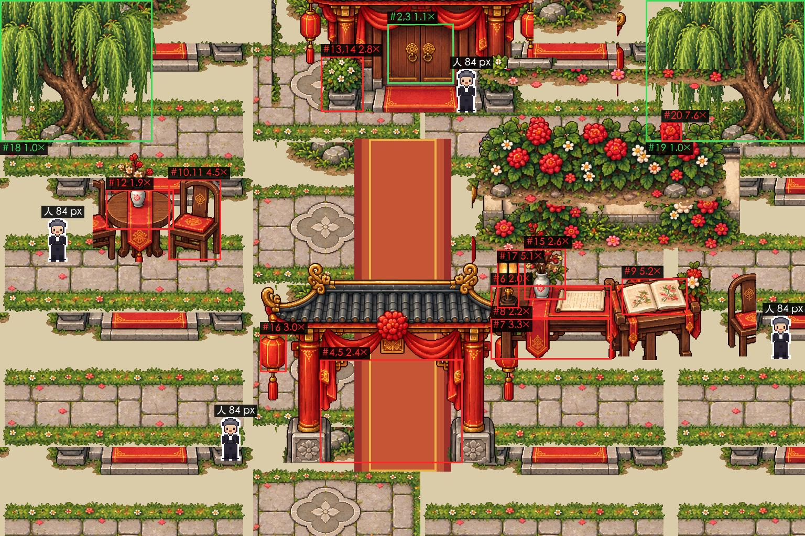

# 比例量尺 · 样本：迎宾院第 43 版占位底图（03，2026-09-24）

> 01 派的：拿第 43 版（887095c）迎宾院的占位底图当第一个样本，对 `比例尺-人等于1.md` 量一遍。工具 `godot/tools/scale_check.py`，两份 skill 见文末。量的人不判放不放行，放不放行是 01 判。

## 结论

**人对，东西大了 2～7 倍。** 量了 14 样东西、20 项：

- **对的 4 样**：人（游戏里 NPC 整帧 84、不透明部分 81，表里 84）、楼门的门扇（宽 126、高 114，都在表里范围内）、两棵柳树（顶被图边截了，量到 ≥270，表里 240～336）
- **大了的 10 样**（14 项红，超出表里范围 1.9～7.6 倍）：一朵花 7.6×、回忆册 5.2×、座灯 5.1×、椅子宽 4.5×、椅子高 3.3×、签到桌前后 3.3×、挂灯笼 3.0×、花盆 2.8×、花瓶 2.6×、签到桌高 2.2×、签到桌长 2.0×、茶桌 1.9×、大门门洞宽 2.4×（**大门有争议，见下第 1 条**）
- 换成「几个人」说：椅子高 1.8 个人（该 0.55）、回忆册摊开宽 1.5 个人（该 0.25）、花盆高 1.3 个人（该 0.3～0.45）、签到桌长 2.7 个人（该 1.0～1.4）——对得上会上说的「桌子、花、书比人大两三倍」，而且更严重（花 7.6×）
- 按「超过 1.5 倍打回」的阈值，**这张图该打回**，和会上定的一致（a1f98d5 撤回是对的）



图上白边的小人是游戏里真的 NPC，1 比 1 贴在楼门旁、大门左脚旁、签到桌右边、茶桌左边，当尺子。编号对下面表里的 #。一眼就看得出：椅子比人高近一倍，回忆册摊开的宽度比一个人的身高还大（125 对 84），大门口的花盆比人还高。

## 怎么量的

1. **图**：第 43 版迎宾院底图，1536×1024，887095c 里的 `godot/assets/layered/scene_luoman_entrance/base.png`（a1f98d5 撤回了，取法写在框文件的 `image_how`；和 ecd4c40 里的是同一张，sha 一样）。原图 1 像素 = 画布 1 像素，不用换算
2. **尺子**：`比例尺-人等于1.md`（人 84 像素；左右和高度 1 米 = 48 像素，地面前后 1 米 = 32 像素）。人不在底图里，在游戏里量：NPC 帧 32 像素高、放大 2.625 倍 = 84，不透明部分 81（`godot/tools/scale_person_84.png` 就是那一帧）
3. **框**：`scale_check.py grid` 把图放大 3 倍盖上 20 像素的格子读坐标，一个东西一个框，高、宽各一项。手读的框误差约 ±4 像素，判的是几倍，用得了
4. **表里没有的**：茶桌按灰盒（直径 68 像素 = 1.4 米）、座灯按 0.45 米 × 48
5. **判定**：超出表里范围 >1.5× 或 <0.5× 红，>1.25× 或 <⅔ 黄。「超出表里范围」= 比上限大按上限算、比下限小按下限算，在范围内 = 1×。会上口头说的「大了几倍」（230 对 100 = 2.3×）是「对表中值几倍」那一列，两列都给；**判定看「超出表里范围」那一列**

## 偏差表（脚本原样输出）

| # | 东西 | 框 | 测得 px | 折合几个人 | 表里 px | 表里几个人 | 对表中值几倍 | 超出表里范围几倍（判定用） | 判定 |
| --- | --- | --- | --- | --- | --- | --- | --- | --- | --- |
| 1 | 人（NPC，游戏里量，不透明像素）高 | 0×0×32×81 | 81 | 0.97 | 84 | 1.00 | 1.0× | 1.0× | 绿 |
| 2 | 楼门 门扇宽（双开门） | 739×45×865×159 | 126 | 1.50 | 86～115 | 1.02～1.37 | 1.3× | 1.1× | 绿 |
| 3 | 楼门 门扇高 | 739×45×865×159 | 114 | 1.36 | 115～145 | 1.37～1.73 | 0.9× | 1.0× | 绿 |
| 4 | 大门 门洞宽（两柱之间） | 610×686×882×884 | 272 | 3.24 | 86～115 | 1.02～1.37 | 2.7× | 2.4× | 红·大了 |
| 5 | 大门 门洞高（地到横梁下） | 610×686×882×884 | 198 | 2.36 | 115～145 | 1.37～1.73 | 1.5× | 1.4× | 黄·偏大 |
| 6 | 签到桌 长 | 936×545×1166×686 | 230 | 2.74 | 86～115 | 1.02～1.37 | 2.3× | 2.0× | 红·大了 |
| 7 | 签到桌 台面前后（深） | 936×545×1166×608 | 63 | 0.75 | 19 | 0.23 | 3.3× | 3.3× | 红·大了 |
| 8 | 签到桌 高（台面前沿到桌腿脚） | 936×608×1166×686 | 78 | 0.93 | 36 | 0.43 | 2.2× | 2.2× | 红·大了 |
| 9 | 回忆册（摊开）宽 | 1186×531×1311×601 | 125 | 1.49 | 19～24 | 0.23～0.29 | 5.8× | 5.2× | 红·大了 |
| 10 | 椅子 高 | 321×342×421×496 | 154 | 1.83 | 46 | 0.55 | 3.3× | 3.3× | 红·大了 |
| 11 | 椅子 宽（含靠背） | 321×342×421×496 | 100 | 1.19 | 22 | 0.26 | 4.5× | 4.5× | 红·大了 |
| 12 | 茶桌 宽（圆） | 202×362×331×438 | 129 | 1.54 | 67.2 | 0.80 | 1.9× | 1.9× | 红·大了 |
| 13 | 花盆（大门口灌木盆）高 | 612×107×693×213 | 106 | 1.26 | 24～38 | 0.29～0.45 | 3.4× | 2.8× | 红·大了 |
| 14 | 花盆 宽 | 612×107×693×213 | 81 | 0.96 | 24～38 | 0.29～0.45 | 2.6× | 2.1× | 红·大了 |
| 15 | 桌上花瓶（连花）高 | 1000×474×1079×572 | 98 | 1.17 | 24～38 | 0.29～0.45 | 3.2× | 2.6× | 红·大了 |
| 16 | 挂灯笼（大门上，灯身）高 | 496×638×546×710 | 72 | 0.86 | 19～24 | 0.23～0.29 | 3.3× | 3.0× | 红·大了 |
| 17 | 桌上的灯（座灯）高 | 948×477×990×588 | 111 | 1.32 | 21.6 | 0.26 | 5.1× | 5.1× | 红·大了 |
| 18 | 柳树（左）高，顶被图边截断 | 0×0×290×270 | ≥270 | ≥3.21 | 240～336 | 2.86～4.00 | ≥0.9× | ≥1.0× | 绿 |
| 19 | 柳树（右）高，顶被图边截断 | 1232×0×1536×270 | ≥270 | ≥3.21 | 240～336 | 2.86～4.00 | ≥0.9× | ≥1.0× | 绿 |
| 20 | 一朵花（花丛里的红花）宽 | 1262×233×1300×270 | 38 | 0.45 | 5 | 0.06 | 7.6× | 7.6× | 红·大了 |

红 14 · 黄 1 · 绿 5（共 20 项）

复跑（在 `godot/回执/` 里，退出码 1 = 有红项）：

```
git show 887095c:godot/assets/layered/scene_luoman_entrance/base.png > /tmp/court_base_v43.png
python3 ../tools/scale_check.py measure 比例量尺-样本-迎宾院-框.json --image /tmp/court_base_v43.png --annot /tmp/标图.jpg
```

## 跟别处对不上的三处（要 01 定／核）

1. **大门：表和蓝图打架。** 表里「院门门洞 宽 86～115（1.8～2.4 米）」，可蓝图（`罗曼山庄-第一关蓝图-v0.2.md` 大门门楼「6 米宽」）和灰盒（`迎宾院灰盒.md`：门洞 x 652～884 = 232 像素 ≈ 4.8 米、门柱高 196）都是迎宾大拱门。图里门洞 272 宽、198 高：**对灰盒宽 1.17×、高 1.0×，对表红（宽 2.4×、高 1.4×）**。我照表记了红，但这条更像是「表少一行」而不是「图错了」。请 01 定：给表加一行迎宾拱门（我的建议：门洞宽 200～250、高 190～200，照灰盒 232×196，数字待 01 定），还是大门就该是表里的小院门。定之前，这张图的打回不靠大门这一行——其余 13 项红已经够
2. **图不但超了表，也超了游戏自己的灰盒。** 灰盒（`layout.json`）里签到桌 144×32、高 38，图里 230×63×78（1.6×／2.0×／2.1×）；茶桌直径 68，图里 129（1.9×）；回忆册上的书 22 宽，图里 125（5.7×）。另外灰盒的签到桌 144 对表里长条桌的上限 115 已经是 1.25×（黄的边上），02 接新图时顺手留意
3. **会议记录里 04 的数我复现不出来。** 记录写「人 45 像素、楼门 151 像素 = 3.4 个人并排」。我量到：游戏里人 84 像素高（手机 540×960 屏上约 79 像素），楼门门扇宽 126、高 114（1.5 个人宽、1.4 个人高，都在表里范围内）。45 更像是人的**宽**（帧宽 42），若是，「3.4 个人」是按人宽算的，不是按人高——**待验证，请 04 核一下量的是哪个框、截图多宽**。不影响结论：桌椅书花是真的大了

## 量不准、不敢说满的地方

- 框是我读格子画的，误差约 ±4 像素；红项都在 1.9× 以上，不受影响；黄项（大门门洞高 198，1.37×）离红线 1.5× 近，看第 1 条
- 两棵柳树顶被图边截了，只有下限，判「绿」只是没超，不等于对
- 「花盆」「桌上花瓶」我按整体（连盆连枝叶）量，表里「一盆花、一丛花 24～38」也是这个口径。「挂灯笼」量的是灯身 72，连吊绳流苏 144；「一朵花」是花丛里最大的一朵红花 38，表里「一朵花 5」是 0.1 米的小花，牡丹类大花 0.15 米也才 7 像素，怎么算都超
- 「签到桌 前后」量的是台面在图上的高度 63（含台面上摆的纸），按前后 1 米 = 32 像素折合约 2 米，表里长条桌深 0.6 米（19），超 3.3×；这一项最容易有争议；就算不算它，签到桌长（2.0×）、高（2.2×）也已经是红
- 只量了这一张底图。第 43 版里其余画布（宴会厅、后厅等）这次没量

## 以后怎么用

- **换图的版本，出码前先量一遍**（9/24 项目会议定，我的建议被采纳）：03 量、写报告，02 在接图关里跑同一个脚本，04 看标图，01 判。报告放 `godot/回执/比例量尺-<场景>-<版本>.md`，框文件和标图放同一个目录
- 工具：`godot/tools/scale_check.py`（PIL）。`grid` 放大读框，`measure` 出偏差表和标图（退出码 1 = 有红项），`bbox` 量带透明的积木，`std` 打标准表。单个积木不用手画框，框文件里写 `png` 就自动取不透明外框
- **脚本里有一份标准表的抄本**（`std` 能打出来），表改了要一起改。02 把表抄进 `godot/ASSETS.md` 时，请同时告诉 03
- 两份 skill 已写：`/Users/kayra_ayu/Desktop/苏七镇奇缘/.claude/skills/scale-check/SKILL.md`（什么时候用、怎么量、阈值、结果写哪）和 `…/phone-screen-test/SKILL.md`（截图和测位置一律按手机 540×960，再过一遍长屏 1170×2532；headless 里第一帧之前设窗口大小不生效）。**这两份在 git 仓库外面（`苏七镇奇缘/.claude/skills/`，和 04 的 `experience-review` 一起），没进这次提交**

## 补记（2026-09-24 晚）

上面「跟别处对不上的三处」第 1 条（大门）已经解决：01 把「山庄大门门楼」一行加进了 `ASSETS.md` v1.1 第 15 节（门洞宽 232、柱高 196、整座宽 344）。**按新行重算，大门门洞宽 272 是 1.17×、门洞高 198 是 1.0×，两项都是绿**，所以这张图是**红 13、黄 0、绿 7**（原来红 14、黄 1、绿 5）；结论「人对，东西大了 2～7 倍」不变。上面的表是按当时的表量的，没改；`scale_check.py` 里已经加了新行（`gate_arch_w`、`gate_arch_h`、`gate_arch_total_w`），框文件里大门两项仍写 `double_door_*`，这样复跑得到的表和这份报告一字不差。
