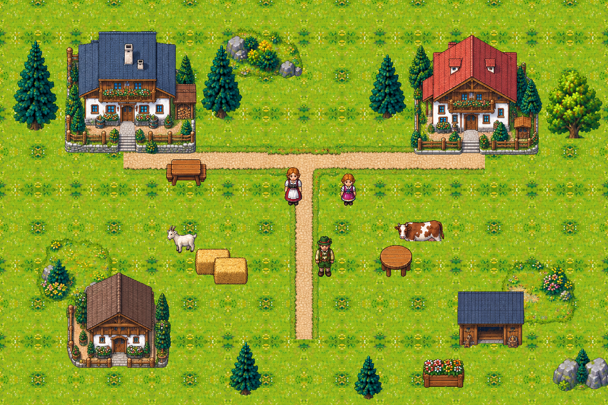

# 零件包试拼 · 拼图构建贝旺（02，9/29）

> 01 D 9/29 派：试一套别人的零件包，看「先画零件、再拼场景」这条路走不走得通。
> 包是阿鱼转来的 `拼图构建贝旺.rar`（15 MB），解压在 `godot/参考/拼图构建贝旺/`：
> - `.gitignore` 挡着，不进仓库
> - 目录里放了 `.gdignore`，Godot 不导入，不进游戏
>
> 拼的脚本 `godot/tools/parts_pack_try.py`，拼出来的图 `零件包试拼-拼图构建贝旺.png`（1536×1024）。

## 结论（先看这段）

**这条路走得通，而且比整张画稳**：位置、大小、前后都在我们手里，一件件换也不牵动别的。
但这套包本身直接拿来用不行，缺的正是我们最需要的几样：
- 没有统一比例：房门只有人的 0.4，小孩和大人一样高
- 没有地面瓦片
- 脚点不统一
- 全都有点半透明
- 22 件底下带着尺寸字

它证明的是**做法对**：一件一个透明 PNG，按脚点摆，按落地先后画，一张图就拼出来了，画风也像一家。给 GPT 定零件规格时，照它的好习惯来，把它缺的几条补成硬规定（见最后一节）。

## 二、这套零件摸清了

**一共 379 件，11 个文件夹，全是透明底 PNG，没有 JSON。**

| 类 | 件数 | 画布（宽×高） | 实画高（中位） | 是什么 |
| --- | --- | --- | --- | --- |
| 阿尔卑斯住宅 | 30 | 64～384 | 117 | 带院子的木屋、小屋、篱笆、院门 |
| 农业建筑 | 30 | 128～384 × 128～320 | — | 仓房、柴棚、草垛、井、菜畦、推车 |
| 地标建筑 | 38 | 64～576 × 64～640 | 110 | 教堂、钟楼一类，最高一件实画 621 |
| 功能组合 | 25 | 128～448 × 128～320 | — | 几件拼好的小组合 |
| 针叶森林 | 50 | 128～256 × 128～320 | 111 | 松树、云杉，最高 253 |
| 草甸自然 + _2 | 70 | 64～256 | — | 不规则草皮、花丛、石头、树桩 |
| 道路系统 + _2 | 52 | 64～320 × 64～256 | — | 土路、石板路的直、弯、丁字、十字，桥、台阶、栏杆、路灯 |
| 生活小物 + _2 | 84 | 64～192 × 64～256 | — | 桌椅、桶、箱、摊子、牲口、人（十几个） |

逐条：
- **透明底**：379 件全是 RGBA，都有透明。但**实心部分的透明度只有 249～251，不是 255**：
  - 379 件里 378 件，实心部分有一成以上像素是半透明的
  - 整件大约 2% 透，叠起来后面的东西会透过来一点，多半是抠图工具留下的
  - 我们的规矩是透明度只能 0 或 255，拿来用得先改；我拼的时候按 ≥128 改成 255
- **尺寸字**：22 件实画下面还留着一行半透明的「192×128」这种尺寸标注，是出图工具留的，放深色底上看得见
- **画布**：宽高都是 64 的倍数（64～640），像是按 64 的格子出的，这个好。但实画和画布下沿之间的空白 0～61 像素不等，**脚点不在画布下沿**，只能每件现量实画的框
- **比例：没有统一的**。拿包里的人当尺子（大人小孩都是实画 96～109 高）：

  | 量的 | 实画 | 折成人（人 = 100） | 我们 §15 该是 |
  | --- | --- | --- | --- |
  | 房门（阿尔卑斯住宅 asset_001） | 高约 40 | **0.4** | 单扇门 1.2 |
  | 小孩 | 98～100 | **1.0，和大人一样高** | 小孩该矮 |
  | 鹅 | 89 | 0.9 | 该在 0.4 上下 |
  | 鸡 / 鸭 | 61 / 46 | 0.6 / 0.46 | 该在 0.2～0.3 |
  | 奶牛（侧面） | 高 54、长 127 | 高 0.5、长 1.3 | 高 0.8、长 1.5 |
  | 最高的松树 | 253 | 2.5 | 我们 §15 柳树、枇杷 3～4 |
  | 最大的住宅（连院子） | 约 310～346 | 3.1～3.5 | 门才 0.4，房子是「微缩模型」比例 |

  - 房子、树按「好看」画小了，人和牲口按「看得清」画大了
  - 每件都是撑满自己那张 64 倍数的画布画的，是图标比例，不是世界比例
- **地面**：**没有能铺开的瓦片**，379 件里没有一件是整块不透明的
  - 草地是一块块边缘不规则的草皮
  - 路是一段段带草边的
  - 我从最大那块草皮中间切了 96×96 当瓦片试，用 `check_tile.py` 验：上下接缝差 20.5、左右 35（要 ≤8），铺开是一格一格的
- **画风**：一家人画的，房顶、木头、花、人的描边和配色都一个路子，视角都是斜俯视，这点比我们 GPT 分批出的强
- **像素**：边是软的、带抗锯齿，放大看不是一格一格的硬像素（我们的规矩是一个美术像素 2×2、硬边）
- **文件名**：乱，比如 `-_2.png`、`二二_.png`、`asset_047.png`、`人_3.png`，看名字不知道是什么；也没有清单说哪件是什么、脚点在哪

## 三、拼了什么、怎么拼的

1536×1024，一张图：
- 3 块草皮、7 段土路（一个丁字路口，往南两段、往东西各两段）
- 20 件立着的：4 栋房子、7 棵树、井、桌、推车、草垛、花箱、3 个人、奶牛、山羊

拼法全在 `tools/parts_pack_try.py`，一条命令出图：
1. **地面**：包里没瓦片，从草皮中间切 96×96，左右上下镜像拼成 192×192 再铺，保证没有硬接缝
2. **路**：按每段实画的框首尾挨着接，不按画布摆。先按画布摆过一次，每段之间都断开一截
3. **立着的**：实画下沿中点当脚点，按脚点从北往南画，南边的挡北边的
4. **透明度**：一律改成 0 或 255（≥128 当实心），顺手去掉了那行尺寸字
5. **比例**：原样用，不缩放

## 四、拼出来怎么样

| 看什么 | 结果 |
| --- | --- |
| **接缝** | 路：按实画框首尾挨着接，竖的、横的都接成一条，丁字路口那里只有一道很淡的草边线；按画布摆就断开，得先量每件实画从哪到哪。地面：镜像铺出来没有硬缝，但重复的花纹一眼看得出，包里得有真的草地瓦片才行 |
| **比例** | 不对：人站在房门前，门到人的腰，房子像玩具；小孩和大人一样高；牲口大小各是各的。单看每件都好看，放一起就露馅，和我们 9/24 迎宾院那次一个毛病 |
| **前后遮挡** | 对：按脚点排，人走到树、房子前后都对。前提是脚点准，这套得每件现量 |
| **像不像一家** | 像：画风、描边、配色、视角一致，放一起不打架 |
| **和 GPT 整张画比** | 零件这条稳：位置、大小、前后都由我们定死；改一件不牵动别的；55 桌那种同一张桌摆 55 遍，只画一次。整张画好看但位置我们管不住（v1 五张位置全跑）、比例会漂、不能拆了再摆。零件这条的风险是分批出的零件画风、比例会不齐——所以规格要比这套严 |

## 五、照这套的做法给 GPT 定零件规格，该怎么定

**一句话：一件一个透明 PNG、按 64 的格子、一张清单说清每件是什么和脚点在哪；比例、脚点、瓦片、透明度、不带字这五条写成硬规定、交件时逐条验。**

1. **一件一个 PNG**
   - 透明度只有 0 和 255（这套是 249～251，要改）
   - 画布宽高是 64 的倍数（这套这点做得好）
   - 一个美术像素 2×2，硬边不抗锯齿
2. **比例照 ASSETS §15**
   - 人 84（大人），小孩另定矮一截；门、桌、椅、树、牲口都照表
   - 每批交件时附一张对照图：每件旁边站一个 84 的人
   - 用 `scale_check.py` 量，超 1.5 倍或不足一半的打回（这套的门 0.4、鹅 0.9 都会被打回）
3. **脚点统一**
   - 实画紧贴画布下沿、左右居中，脚点就是画布下沿中点
   - 做不到的，清单里写脚点像素
   - 这套下沿空 0～61 不等，只能现量
4. **地面、路、墙成套出瓦片**
   - 草地、地砖：整块不透明，四边能无缝接，`check_tile.py` 验，接缝差 ≤8（这套没有）
   - 路、红毯、墙成套出：直、弯、丁字、十字、端头
   - 每套的接口宽度、边缘位置定死在画布边的固定位置，拼的时候不用量
5. **带一份清单 JSON**
   - 一件一行：文件名、类别、画布、实画框、脚点、占地、挡不挡人
   - 文件名用有意义的英文或拼音（比如 `blk_table_round_v1`），不要 `二二_`、`asset_047`
   - 阿鱼在用的网页拼接器能导出 PNG 和 JSON，摆法可以在那儿摆，JSON 交给 02 转成游戏的场景配置
6. **不带字、不带尺寸标注**：这套 22 件底下留着「192×128」，交件前要查
7. **先有清单再画**：先按场景列清单，一件对一行（像 55 桌摆位表那样），GPT 照清单画，02 照清单验、照清单拼。不让 GPT 自己发挥件数和大小

## 风险

- 这套包是别人的，只拿来试做法，不进仓库、不进游戏。拼出来那张图也只放回执里给 01 看
- 拼出来的图没按我们的比例缩：包里的人约 100，我们 84，要缩 0.84 倍，像素画缩非整数倍会糊。这也说明零件得一开始就按我们的比例画，不能拿来再缩
- 包里没 JSON，我对哪件是什么是看缩略图认的；换一套包要重认
