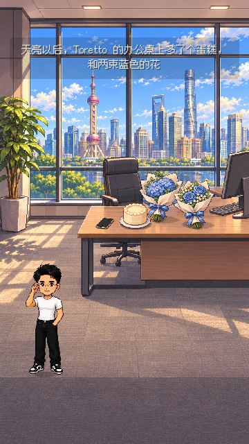
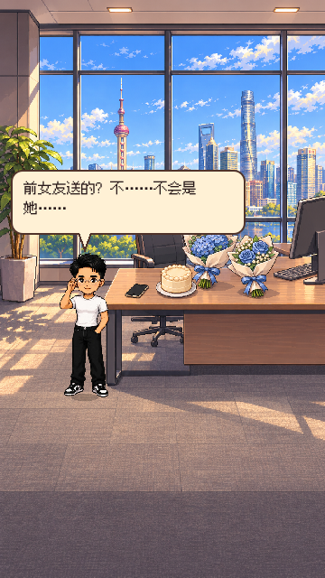
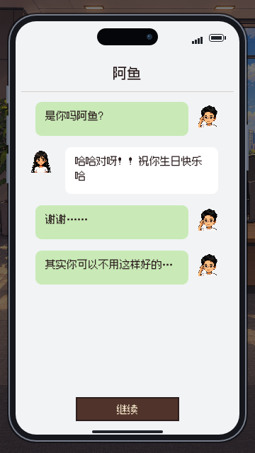

测试源码：`c3d835c05a8e595c561084d84e49d79a4aa846aa`；叠加依赖 UI1 PR #39（f1ee650）；D2，2026-11-06。

# D2-K2 · 上海CBD办公室，待判

按阿鱼本线程「上海CBD中心办公室样式」「还原Toretto在办公室里收到花」：替换桌面特写为落地窗/上海楼群/办公桌中景，Toretto全身在场并由玩家走到桌边。只有当前一个热点：蛋糕A3-2j→两束蓝花A3-2k→桌上手机A3-2l～2p。对白用头顶气泡，旁白用UI1顶部轻底；五条手机消息保留原顺序，能上下拖读，10秒按钮不会跳掉整段聊天。

[16项原生360×640/触摸/JSON续档记录](D2-K2-2026-11-06/office.log)全部无失败：远处不自动取物、未来热点不生效、顺序/原稿不变、续档保留Toretto/位置/当前目标、最后回阿鱼时间线。三图从开发检查点进入，不是完整真机通关。

背景使用内置image_gen，保存 `godot/hongyuan/assets/w2/call/bg_cbd_office_r2.png`（941×1672）；旧图保留。图像没有烘焙Toretto，使用原人物素材叠加，避免一人两份。manifest状态pendingReview，D4审图/体验、D1核稿、Claude审代码均未判。

生成提示：将旧蛋糕和两束蓝花桌面特写拉远为上海CBD高层日间办公室中景，落地玻璃窗/上海天际线、工作桌椅、一只奶油蛋糕、分别包装的蓝绣球与蓝玫瑰两束花、一部黑色iPhone。对齐项目暖像素样板，9:16；桌在中部偏右，左侧及下方留Toretto走路站位；无烘焙人物、无文字/水印，不画住宅书房。原Toretto仅作比例参考。原始生成文件保留在Codex generated_images。

本PR只交K2，基于UI1分支便于复用新字幕/手机；UI1合入后应改基线hongyuan-launch再合K2。未自行合并或正式出包。其他章缺项沿用最新八章交接表。
