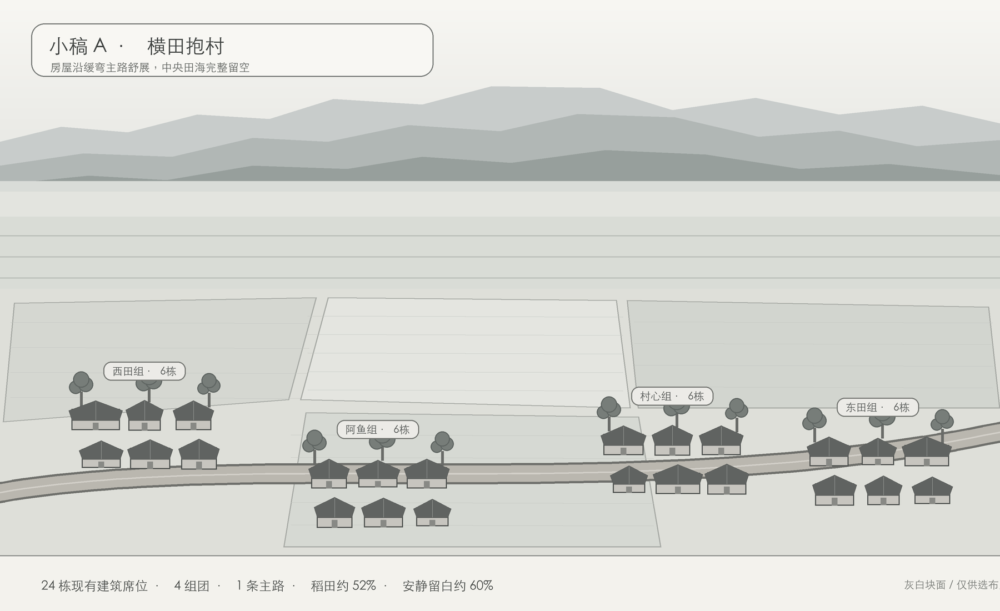

# 小稿 A《横田抱村》K1～K12 对照表

| 编号 | 结果 | 图面检查 |
| --- | --- | --- |
| K1 | 过 | 共预留 24 个现有建筑席位：19 户、阿鱼家及四处典型建筑；小稿只用灰白块表示已有建筑的位置，不新增建筑类型，不改建筑外形。 |
| K2 | 过 | 顶部为天空和三层峨眉山雾脊，中部为铺到山脚的远田，下部为村落与近田。 |
| K3 | 过 | 峨眉山采用前低后高的三层低饱和灰蓝剪影，主峰为平顶长山脊，不画山体细节。 |
| K4 | 过 | 稻田约占 52%，均为大块连片田面，只留细田埂；没有麦田、花圃、荷塘和散落草垛。 |
| K5 | 过 | 天空、雾带及连续田面形成约 60% 的安静留白，中央田海不放房屋和装饰。 |
| K6 | 过 | 24 栋建筑分为西田组、阿鱼组、村心组、东田组四团；组团共用树木背景，不设逐户围墙和圆土坪。 |
| K7 | 过 | 只有一条横向缓弯主路，没有 Y 字、环路及额外岔路；入户依靠田埂步行。 |
| K8 | 过 | 每组只留三处共享竹木背景，共 12 处树簇，集中在屋后，较旧图减少 60% 以上。 |
| K9 | 过（小稿） | 当前为灰白构图；成图锁定青灰瓦为主、红顶不超过 3 栋、低饱和暖斜阳。 |
| K10 | 过 | 图中无桥、无穿村河流。 |
| K11 | 过（结构预留） | 连片田面与统一构图可直接复用于春水田、夏青田、秋金田、冬霜田四季版本。 |
| K12 | 过 | 房屋基准宽度与主路比例统一，主路按一人步行宽度表现；树只略高于屋脊。 |

