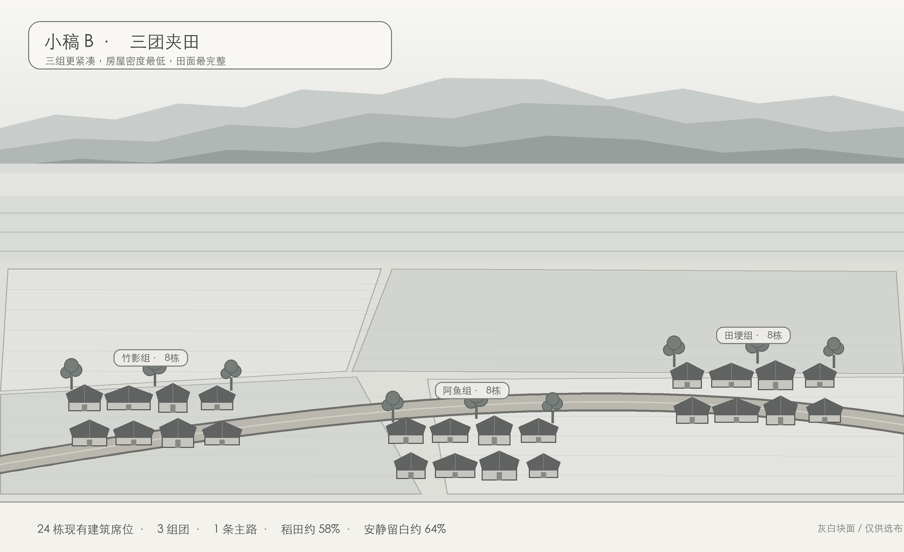

# 小稿 B《三团夹田》K1～K12 对照表

| 编号 | 结果 | 图面检查 |
| --- | --- | --- |
| K1 | 过 | 共预留 24 个现有建筑席位：19 户、阿鱼家及四处典型建筑；小稿只用灰白块表示已有建筑的位置，不新增建筑类型，不改建筑外形。 |
| K2 | 过 | 顶部为天空和三层峨眉山雾脊，中部为横向远田，下部为三个村落组团与近田。 |
| K3 | 过 | 峨眉山采用前低后高的三层低饱和灰蓝剪影，主峰为平顶长山脊，不画山体细节。 |
| K4 | 过 | 稻田约占 58%，是三案中田面最完整的一案；只用少量细田埂划分大田。 |
| K5 | 过 | 天空、雾带及连续田面形成约 64% 的安静留白，房屋不侵入中央大田。 |
| K6 | 过 | 24 栋建筑分为竹影组、阿鱼组、田埂组三团，每团 8 栋；取消逐户围墙与圆土坪。 |
| K7 | 过 | 只有一条浅弧主路从三团前方穿过，没有 Y 字、环路及额外岔路。 |
| K8 | 过 | 每组仅三处共享竹木背景，共 9 处树簇，是三案中树量最少的一案。 |
| K9 | 过（小稿） | 当前为灰白构图；成图锁定青灰瓦为主、红顶不超过 3 栋、低饱和暖斜阳。 |
| K10 | 过 | 图中无桥、无穿村河流。 |
| K11 | 过（结构预留） | 最大面积的连片田面便于保持同构图四季替换，春夏秋冬视觉差异会最清楚。 |
| K12 | 过 | 三团使用同一房屋与道路比例，主路按一人步行宽度表现，树木高度克制。 |

