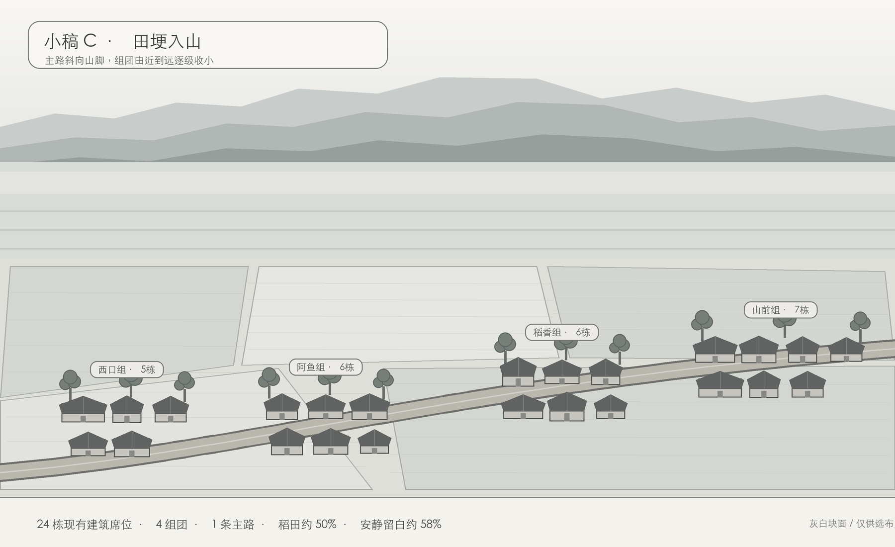

# 小稿 C《田埂入山》K1～K12 对照表

| 编号 | 结果 | 图面检查 |
| --- | --- | --- |
| K1 | 过 | 共预留 24 个现有建筑席位：19 户、阿鱼家及四处典型建筑；小稿只用灰白块表示已有建筑的位置，不新增建筑类型，不改建筑外形。 |
| K2 | 过 | 顶部为天空和三层峨眉山雾脊，中部为铺到山脚的远田，下部为斜向展开的村落与近田。 |
| K3 | 过 | 峨眉山采用前低后高的三层低饱和灰蓝剪影，主峰为平顶长山脊，不画山体细节。 |
| K4 | 过 | 稻田约占 50%，沿主路两侧形成五块连续大田；没有零碎混种地块。 |
| K5 | 过 | 天空、雾带及连续田面形成约 58% 的安静留白，左上与中央田面保持净空。 |
| K6 | 过 | 24 栋建筑分为西口组、阿鱼组、稻香组、山前组四团，组团由近到远递进；无逐户围墙及圆土坪。 |
| K7 | 过 | 一条主路缓缓斜向山脚，没有 Y 字、环路及额外岔路；房屋顺着路与田埂自然落位。 |
| K8 | 过 | 每组仅三处共享竹木背景，共 12 处树簇，全部压在屋后。 |
| K9 | 过（小稿） | 当前为灰白构图；成图锁定青灰瓦为主、红顶不超过 3 栋、低饱和暖斜阳。 |
| K10 | 过 | 图中无桥、无穿村河流。 |
| K11 | 过（结构预留） | 同一斜向田块构图可直接替换春水、夏绿、秋金、冬霜四种稻田状态。 |
| K12 | 过 | 远处组团只做透视缩小，房屋、树和主路的基础比例仍与阿鱼家院前基准一致。 |

