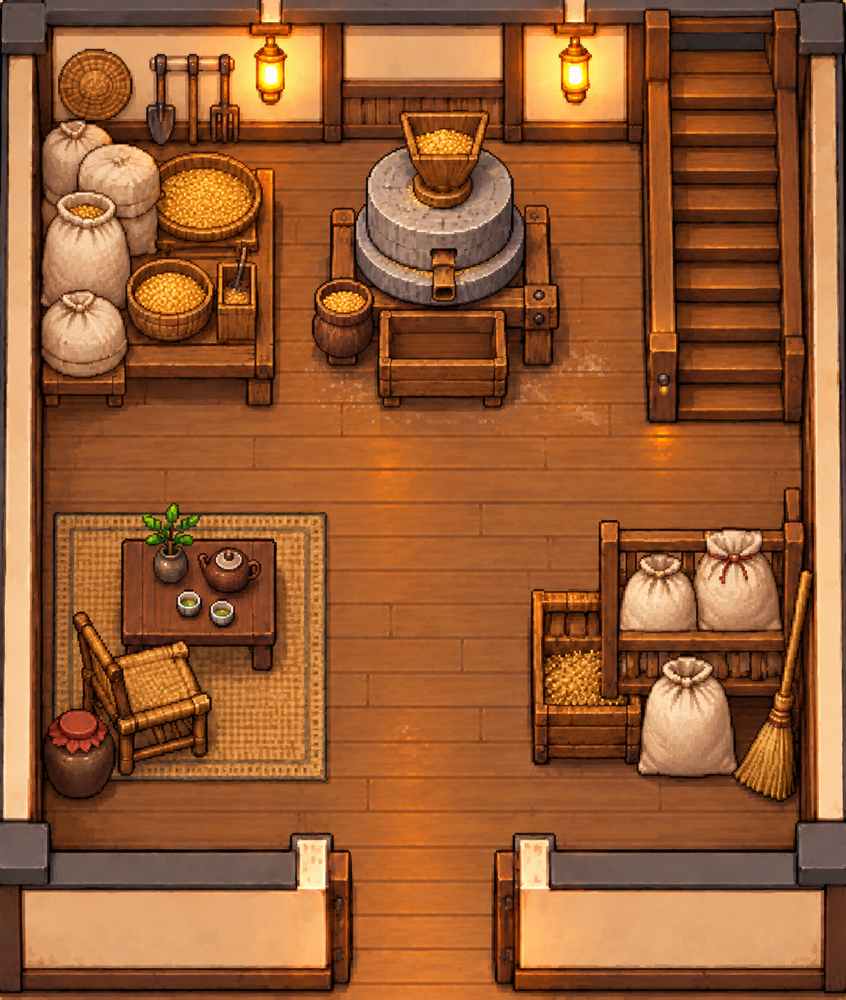
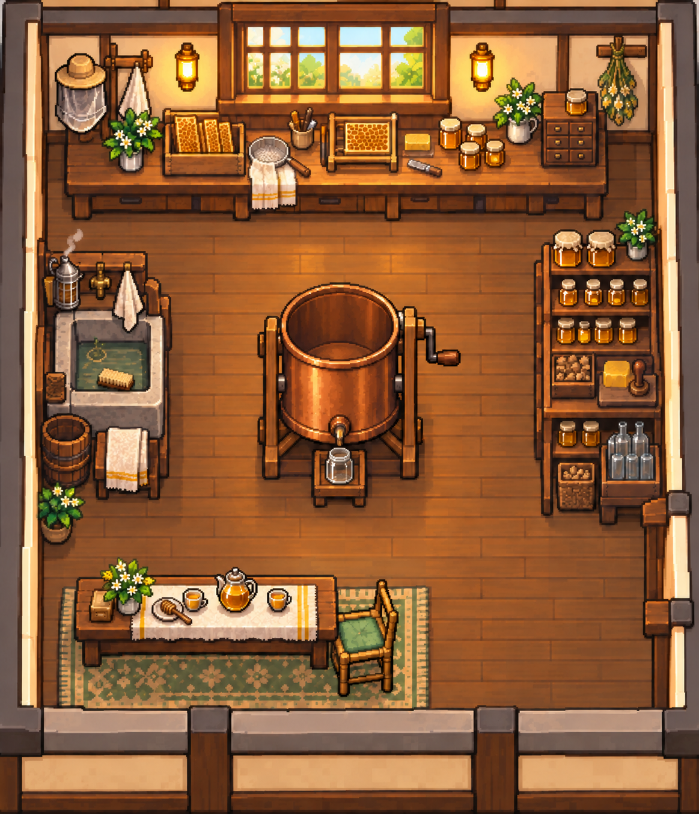
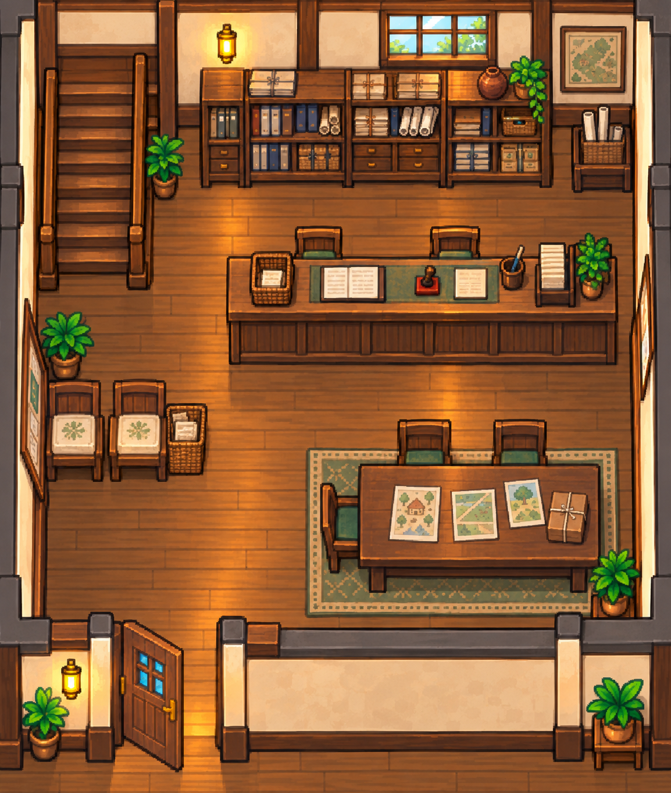
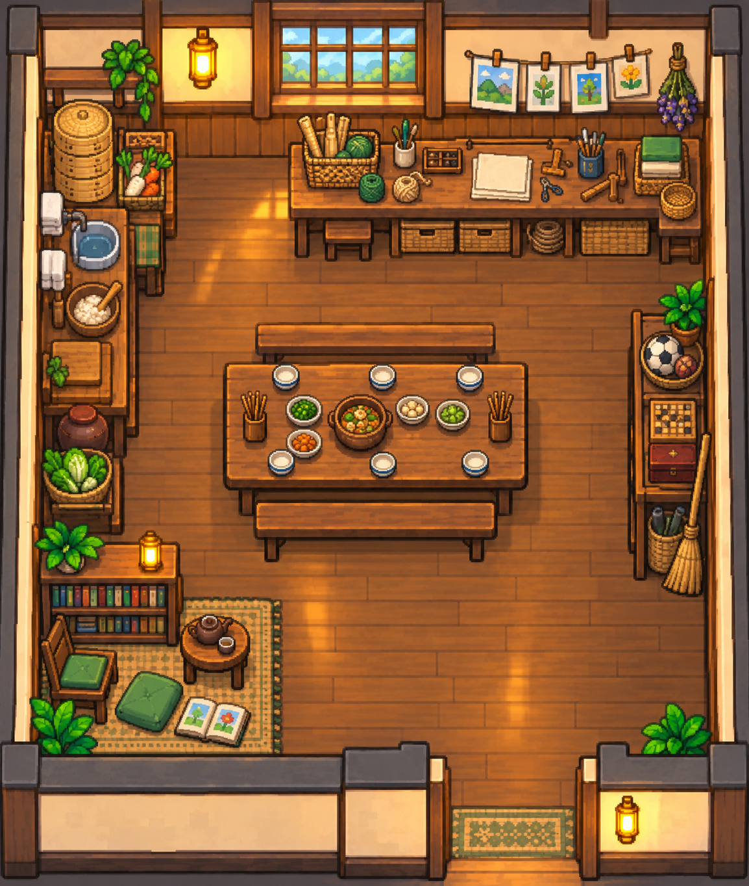
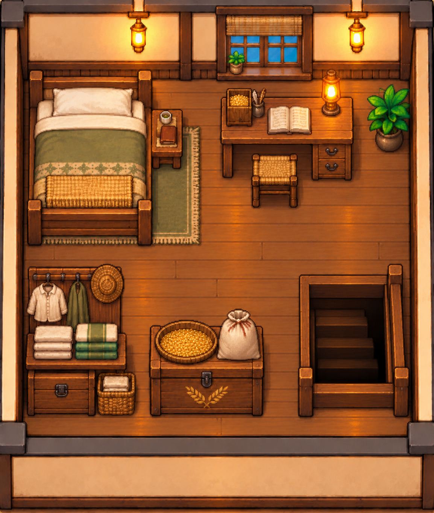
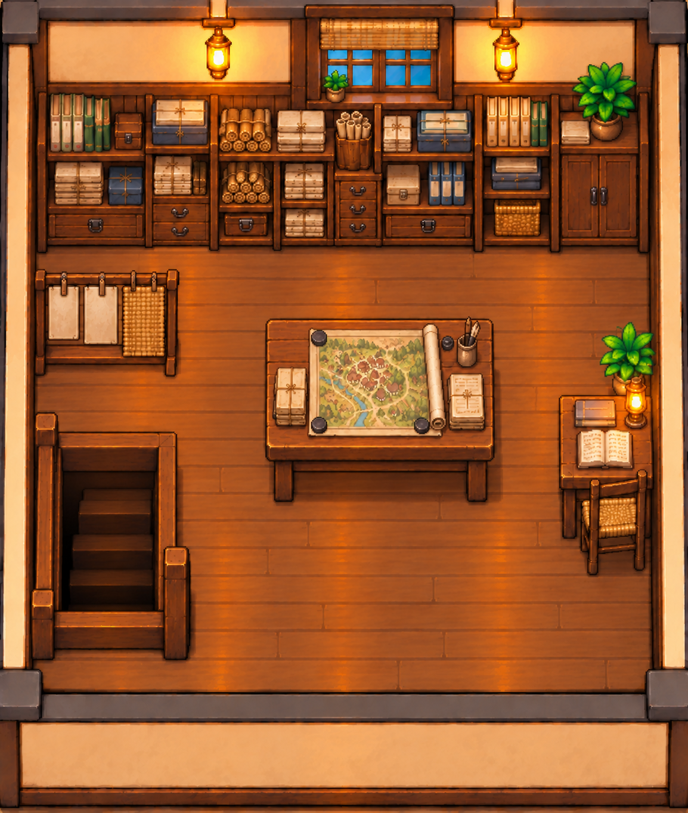

# 四处画面与附属二楼预览

2026-10-13，C4已实际看过下列源图。展示的是美术源图，尚未完成每处工程接入和运行验收；原人物84px，目标房间508×600，实际坐标以最终素材索引指定接口为准。

## 小涛磨坊

接口：[底图接口-v2.json](小涛磨坊/底图接口-v2.json)。

## 凯凯蜂蜜小院

接口：[实图接口-v3.json](凯凯蜂蜜小院/实图接口-v3.json)。

## 村委会

接口：[实图接口-v3.json](村委会/实图接口-v3.json)。

## 村民活动中心

接口：[实图接口-v3.json](村民活动中心/实图接口-v3.json)。

## 小涛休息储物二楼

接口：[v_h3_up-实图接口-v2.json](附属二楼/v_h3_up-实图接口-v2.json)。

## 村委会资料室二楼

接口：[v_mayor_up-实图接口-v2.json](附属二楼/v_mayor_up-实图接口-v2.json)。

四处门位、组团与动线不同，二楼前墙封闭、向下梯井；角色头像、独立磨杆、九件可制作家具、经济表和生成提示词见[设计交付回执](05-C4设计交付回执.md)与[最终素材索引](最终素材索引.json)。
