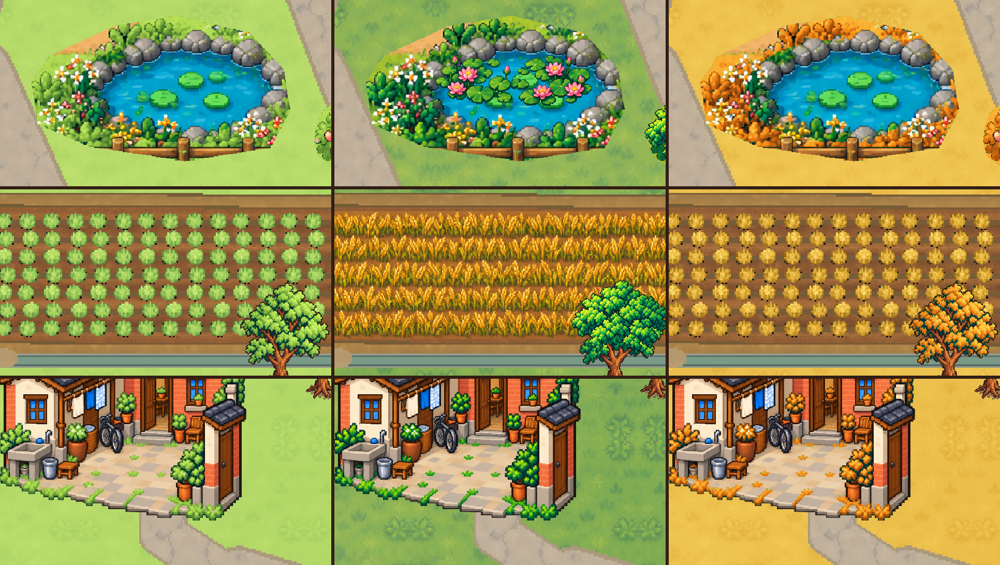

# 夏秋、荷塘与夏午麦田，待核图接入

2026-10-14。依据总001追加及阿鱼本聊天“猛烈阳光、繁盛树木、热浪、麦田”补充制作。已看4127b2a门前春夏、东田夏秋真实图和完整村图。**唯一接口：`C2夏秋荷塘接入-v1.json`。** 春季沿用生产现版，冬季保留；本包为设计素材与接口，未接入、未实机判过。

同机位预览：**列从左到右春/夏/秋，行从上到下荷塘/麦田/门前**；每格640×360、13时晴天、scale1.15，都是原生材质与资产合成，不是游戏截图，没有HUD/人物。

## 本波实际素材与布局

- **盛夏树冠**：20株已有独立树/果树加厚冠层，约增宽10%；h7烘焙庭院树另加一层放在整屋图后面，屋顶仍在前。树干、脚点、根框保持原值。共21顶冠层，非新树根。
- **盛花**：在18处已有花带内放36组新盛花，80×32或70×28，交错镜像/尺度；低层可走，不新增碰撞，春秋冬隐藏。原庭院图不重画。
- **荷塘**：采用既有`public_pond`，原塘435×245、世界[1035,1000]。夏荷265×88放[1150,1065]、在原水面上，岸石、花边、围栏与水色保持。喂鱼点[1450,1250]、走近点[1450,1280]不改。若现有水面尚无实体，只补接口三小矩形水域；南/东塘岸保留可走空间，不把整个塘贴图变成墙。其他季节回原塘，不新增任务/奖励。
- **麦田**：东岸既有`c4_field_4`内部[3850,3320,585,215]夏季换成连续密植金色麦穗，外围20px田埂、沟和田路保持。只是季节景观，不改变玩家真实种田/收成/物品。
- **秋季**：复用当前植物控制遮罩，只将草、田间植物、落叶/果树冠与庭院植物映射到金黄/橙黄，保留暗轮廓。常绿竹少量泛黄；墙、瓦、道路、水和人物不靠整屏滤镜改色。

## 阳光、热浪与声音接入

夏秋植物shader读取当前spring遮罩及绑定文件，无新控制纹理。新`summer_sun`由C2按天气和时间更新：晴1、云.25、雨雪0；8～9.5渐入、9.5～15.5强、15.5～17.5渐出，夜间0，室内0。增强暖叶面高光，配合新增盛花、厚树冠和麦田；维持原天气/早晚环境光，不加全屏过曝滤镜。四个新素材也跟原环境光、雨色变暗，不设自发光。

`麦田热浪.gdshader`只取麦田自己的TEXTURE，不用screen_texture，因此不扭人物/HUD。晴天12～16时、夏季且效果开启才渐入，最大位移约1世界像素，产生上行轻微折射；其他时间/天气为0。C2把`field_world_size`设585×215，沿现有雨参数传`rain`。**[动效示意](麦田热浪-材质动效示意.gif)**为20帧材质数学预览，不是已运行热浪。

蝉鸣由C2使用已有可用声音或免费原生合成：夏季户外10～17时晴暖最明显，云天减弱，雨/夜/室内关闭，短促间歇颤鸣、低音量；服从现有声音开关、总音量和对话压低规则。无付费服务或新增设置页；此包不冒称声音已接入。

## C2 机械接入与检查

复制`assets/`四张最终小尺寸PNG和两个shader，按JSON精确坐标/尺寸/层级添加季节层；不从高清源图重新创作、不重排地图。原图、入口、路网及旧根框不改。`tree_crowns`要挂在原根组，h7的before/其他after顺序必须按接口；低花和麦田放地面后、建筑/NPC/玩家前，荷花在原塘上。

村庄材质换成本包夏秋shader，继续绑定当前`c4-spring-v1/bindings.json`，保留所有原参数更新。春/冬分支与生产现版逐字核对相同；其他户外不替换。冠层/花/荷/麦只在夏季可见，秋季仍由原田块金黄植物显示。若补水域实体则只烘村庄导航，并实走塘岸/喂鱼点。

成本：**4张最终贴图合计约0.67 MiB RGBA、59个夏季小Sprite、0新树根、0新增控制遮罩内存**。原生无窗口检查已解析两shader的全部uniform；静态哈希、花带边界、荷塘范围、田边余量及春冬一致性已核对。真实性能/热浪感/晴雨昼夜/蝉鸣/行走遮挡仍由C2接入、C3实际验证。

图片用内建image_gen生成，原图与提示词保留在本目录；最终贴图由原生引擎按记录机械裁边、nearest缩放，保留alpha，未重绘已有源图。完整提示词见`生成提示词-四项.json`。无窗口导出时的用户数据目录/系统证书提示未阻止导出和shader解析；生产编译仍由C2。

本波开工实查额度剩41%，结束值见`00-C4状态.md`，30%冻结/15%强停保持。仅写设计目录，无生产/Git/游戏窗口操作。C4本波交付后待命，仅按明确接入/验收问题修正。
