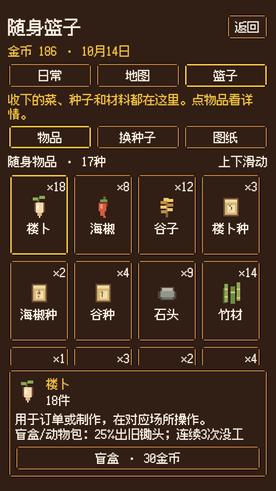
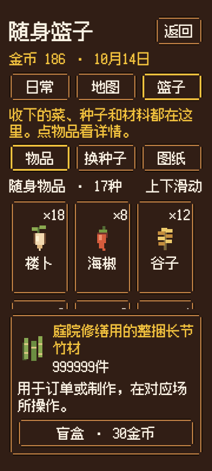

# 手机篮子紧凑版 v1，待 C1 核图

**已被C1退回并由v2收紧稿取代。此v1不接入，唯一后续接口为`../v2/C2篮子接入-v2.json`，仍待C1核图。**

2026-10-14，2期独立小阶段。C4已交可点版图、三个尺寸预览、图标和C2尺寸/操作接口。**仅设计预览，未接入游戏，N6未测。** 村外v2已获C1静态批准，交C2按唯一地图接口接入；本包不再改地图。

## 先看版图

540×960普通库存：

开包操作与制作页：`篮子-540x960-parcel.png`、`篮子-540x960-plans.png`。长屏：`篮子-540x1200-items.png`。窄屏：`篮子-360x800-items.png`。

长名和大数量的窄屏案例：

`手机篮子-可点版图.html`可点物品与三个页签，可滚动；所有库存、金币、图纸状态是明确标注的设计样例，按钮只提示设计预览，不消耗或伪造真实库存。不是游戏截图。空篮、未获得图纸、材料不足另有PNG。

## 展示与操作结构的来源

参考[星露谷官方站点 Wiki 的 Inventory](https://wiki.stardewvalley.net/Inventory)：库存按格列展示、在菜单里查看完整持有物，便于一眼比较。本村采用手机四/三列，不引入其背包容量、扩容、丢弃、拆分、整理或快捷栏功能。

参考[任天堂《Animal Crossing: Wild World》正式说明书，第11～13页](https://www.nintendo.com/eu/media/downloads/games_8/emanuals/nintendo_ds_21/Manual_NintendoDS_AnimalCrossingWildWorld_EN.pdf)：先点选物品，再显示该物品与当前场所适用的操作。本村把既有操作移到固定详情区，避免在长列表中寻找。未复制两款游戏的图形、图标或皮肤。

## 现状、素材与新布局

原`core/interface.gd:235`起仅用`state.describe(items)`排库存全文，随后是三种换种子、盲盒、动物包、十二个制作行，制作按钮每件独占一行。没有独立普通库存图标集。已核对`config.gd`、`state.gd`的真实键与指令，保留已有作用；选择状态只用于展示，不绑定到农田的`selected_crop`。

- 字体沿用`fusion-pixel-12px-proportional-zh_hans.otf.woff2`；正文/数量/按钮24、标题36，不用小于24字号塞内容。
- 沿用现有深褐底、金棕双线、名字黄与喜红主按钮。Godot接入复用`UI.theme()`、`UI.secondary_box()`、`UI.primary()`和`dialog_skin.gd`，不用HTML边框代替游戏现有皮肤。
- 12件家具形象全部复用：9张已接入craft PNG，竹椅/小木桌/花架复用现有`furniture_draw.gd`矩形；时令果复用`botanical-6.png`。不重绘这些素材。
- 缺少的16个普通物品小图标由C4补为原生像素矢量，32×32整数格、不加新物品。`物品图标接口.json`是精确矩形/颜色合同，`物品小图标.gd`是可机械复用的绘制辅助；SVG供看图和其他原生导入，不要求二次创造美术。
- 本期17个真实物品key全覆盖。保留配置里的“楼卜”等现有称呼，不自行改字。未知旧存档key用已有篮子通用图标并显示`state.item_name(id)`，不静默丢库存。

## C2 实现接口

唯一数据入口`C2篮子接入-v1.json`。这是一套篮子专用布局，不改全局窗口/stretch或其他页面。

结构为全屏安全边距→VBox：页头、金币日期、原日常/地图/篮子导航、两行反馈、物品/换种子/图纸页签、列表提示、**可伸展ScrollContainer→GridContainer**、**固定详情PanelContainer**。详情不在列表Scroll内。540宽4列、有效宽小于420时3列；更长屏只增加列表可见高度。没有空格数量或容量上限的暗示。

| 部分 | 尺寸（UI设计单位）/策略 |
|---|---|
| 外边距 | 左右16；上max(28,安全区)、下max(26,安全区) |
| 常规间距 | VBox/网格8；图标与详情文字12 |
| 列表 | EXPAND_FILL，min height 0，竖向滚动，横向禁用；为滚动条预留12 |
| 物品格 | 高160，按列均分宽，最小触控44×44；图标48×48居中，数量28高、名字58高 |
| 字/长名 | 正文24、标题36；格内最多2行省略，详情保留完整名称，最长名称单独可滚动 |
| 数量 | 格内≤9999显示真值，超出显示9999+；详情始终显示完整整数 |
| 详情 | padding12；选中头至少56；说明58高可滚动；最大280（窄屏312），不压到底部安全区 |
| 按钮 | 最小高48、左右内边14；宽屏有主操作时两列，<420改两行；无物品操作只留盲盒一行 |
| 页面切换 | 只切展示分组，不改库存；新组首项默认选中，已有选择仍存在则保持 |
| 状态刷新 | action结果沿现有notice/state.changed更新；列表重建保存组、选中id及滚动位置，不新增每帧查询 |

以上是容器约束，**不将预览测出的坐标硬填为Godot子控件position**。Godot字形/皮肤边距略有差异，按同一字号与最小尺寸让容器排版。项目目前540×960基准、canvas_items/expand；360窗口不可仅把整个540布局缩小：按最终可用宽做3列，并核对最终显示/输入坐标下按钮至少44×44。如需局部缩放补偿只作用篮子专用根，安全区与鼠标坐标保持同一坐标系，不改世界相机/全局stretch。真实手机DPI由C2沿现有平台策略处理，C3检查实际显示与点击。

普通物品只看数量/说明，不能凭选中添加“使用/出售/丢弃”。动物包选中时`action("parcel")`；换种子组列出三种（0也显示），调用`action("seed", {"crop":...})`；图纸列十二件，详情显示是否已学会及真实材料已有/需求，调用`action("craft", {"id":...})`；盲盒按钮始终在固定区，调用`action("box")`。种子3、盲盒30、25%工具/连续3次未得工具下次保底/重复图纸换3竹材均读config，不将示例数字写死。

没有包/金币不足/未学会/缺材料时禁用对应按钮并保留原因；原state.act仍为最终校验。不增加家具摆放动作或普通物品跳转，摆放仍在院子页。原日常、地图、返回继续原函数。

触摸拖动仅列表滚动，手势越过阈值不触发格子选择；轻点只选中，消费必须再按操作按钮。键盘/手柄打开时聚焦第一可见格/返回；方向键按列数移动、焦点项滚入可见区，tab进入页签和固定按钮，取消沿原close；切页/重建恢复合法焦点。焦点描边和选中描边可同时辨认。

## 已核对与留给实机的项目

独立无窗口浏览器在C4设计目录核对10个尺寸/状态案例：540×960、540×1200、360×800；开包、换种、制作、空篮、长名999999、未学会、缺材料。所有整页不溢出，字体加载、4/3列、底部按钮≥44、滚至末项可见，滚动时详情不移动且在列表下方；点蜂蜜后详情变化、Tab能到Button。两行名字曾被格子下沿裁切，已将格子加高到160并重新导出最终图。记录`版图浏览器核对.json`。

这是版图检查，不是Godot生产代码、存档、消费、触摸手势或N6通过；`物品小图标.gd`尚待C2在生产工程编译。C1先核图；C2按接口实现、稳定提交后C3做N6真实540×960/540×1200及窄屏：真实选择、每类原操作/数量变更、滚动不遮底部、长名/大数量/空篮/缺材料、返回与焦点。不要用本包样例状态截图替代真实库存证据。

本波开工实查剩余89%；最终结束实查84%，普通使用可用，30%冻结/15%强停规则保持。C4只写设计目录，未改生产/Git，未操作C3游戏窗口。无额外付费服务、无调用生图API。
