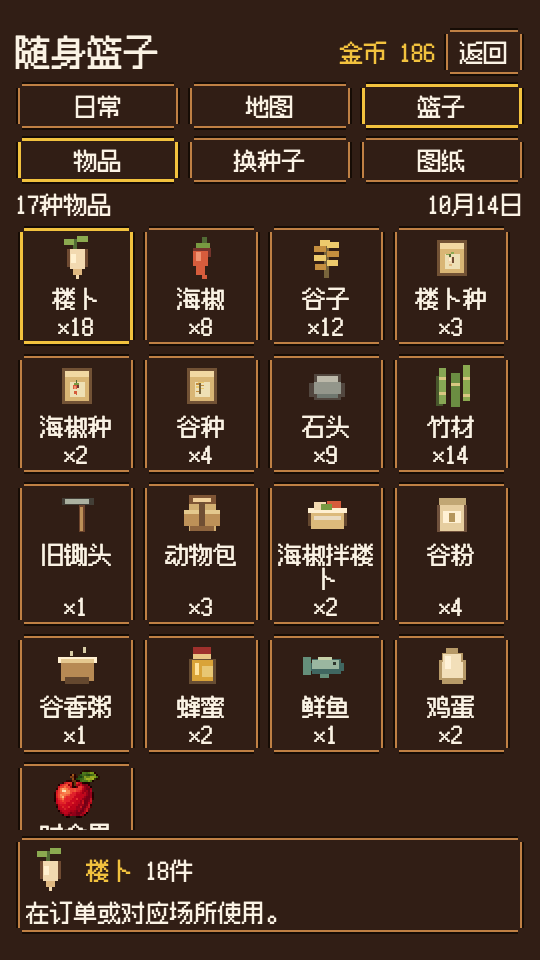
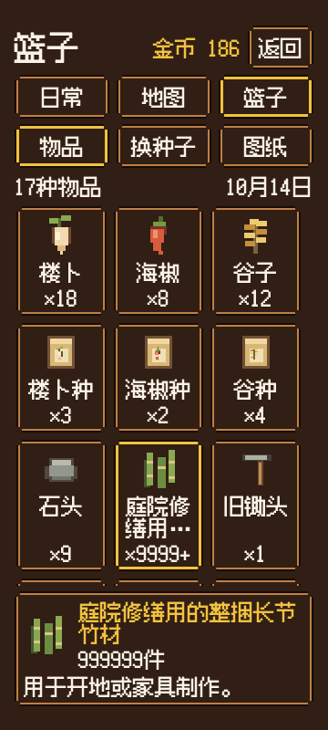

# 手机篮子 v2 局部收紧稿，已获 C1 静态版式批准

2026-10-14。按C1退回意见，只收紧布局和既有操作的展示位置；字体、图标、美术配色及库存功能不变。**v1不接入，唯一接口为本目录`C2篮子接入-v2.json`。N6仍未实机测。**

同540×960库存修稿：

同360×800长名/大数量修稿：

## 本次收紧

| 部分 | v1 | v2 |
|---|---|---|
| 顶部 | 标题、单独金币行、导航、常驻两行说明、分组、列表标题 | 金币并入页头，日期并入列表提示，去掉常驻说明；原导航与分组保留 |
| 列表起点 | y约338 | y224 |
| 物品格 | 固定160高、姓名预留两行 | 常规最小120高，名字实际一/两行自适应；有长名的整行约144高 |
| 普通物品详情 | 212高，常驻盲盒说明和按钮 | 98高，只显示选中图标、全名、完整数量及一行相关用途 |
| 首屏完整物品格 | 540库存8个；360库存/长名稿3个 | 540库存16个；360库存/长名稿9个，末行可继续滚动 |
| 消费操作 | 固定区混放相关操作与全局盲盒 | 选中动物包/种子/家具才出现其明确操作按钮；盲盒在图纸组有独立标价入口 |

正文、名字、数量、按钮仍24，页头36；图标48，最终触控最小44×44。540四列，<420三列。常规格子减少留白，长名字仍最多两行省略；固定详情显示完整名称和完整整数。没有新增图标或改素材。

盲盒入口是**图纸组首格“金币盲盒 / 30金币”**，属于既有服务入口，不是玩家持有物、图纸或新增容量格。复用已有包图标。点选后才在固定详情显示原概率/保底/重复图纸说明，并显示“买盲盒 · 30金币”；点击格子不消费。返回、日常、地图、换种子、开动物包、制作和盲盒均保留，仍调用原指令。普通食材不显示全局概率说明，也没有虚造的使用按钮。

## C2 容器与尺寸

安全边距→VBox：**页头HBox（标题/金币/返回）→原导航Grid3→物品/换种子/图纸Grid3→数量与日期HBox→可伸展ScrollContainer/Grid→固定详情Panel/VBox**。反馈只在现有操作产生后更新详情说明；不预占顶部说明行。

左右16，上max(28,安全区)、下max(26,安全区)。主VBox间距6、网格8；格padding垂直6/水平4、图标48、名字24行高、数量24行高，最多两行名字。Grid按同一行最高格排，不给所有名字固定58空白。详情padding8、间距6，选中头最少48；名字与数量能同行则同行，长名字自然换行，完整名称最大72高可滚动。相关说明一行24、最多两完整行48可滚动；有动作才放最小48高的全宽主按钮，无动作不留按钮空行。说明不足的原因放在材料清单前。详情最大264，列表占其余高度；详情不在列表Scroll内。

原字体/皮肤、图标绘制辅助、真实物品键、数量>9999缩略/详情完整、空篮、存档未知物品、焦点恢复、滚动手势不误点、真实状态和指令等沿v1已有合同；以v2尺寸与操作位置覆盖冲突项。现有素材字节未变。按最终可用宽选列数，实际按钮至少44；不改全局stretch/其他页，不照搬浏览器坐标硬设容器子节点位置。

图纸组含12家具和1个盲盒服务入口，打开默认选第一件家具，保留合法选择；服务不计入12张图纸。材料/价格/概率均读取config，设计样例库存不能带进生产存档。原state.act仍作最终消费校验。

## 本波检查与交接

独立版图检查11个尺寸/状态：540×960、540×1200、360×800；盲盒、动物包、换种、制作、长名999999、空篮、未获得图纸、材料不足。无整页溢出，末项可滚至可见，详情不随列表移动，操作按钮满足触控下限。图片和`版图浏览器核对.json`为本次新输出，素材哈希与v1相同。

这是设计版图，不是生产操作/触摸/存档/N6通过。C1已核540×960与360×800及修稿，静态版式批准，已派C2只按v2接口实现；C3再做实际N6。v1仅保留为对照，不再接入。C4转待命，仅接入定位或验收明确问题后修正。

本波开工实查额度剩余84%、结束83%。30%冻结/15%强停保持。C4只写设计目录，无生产/Git/游戏窗口操作，无新增美术或功能。
