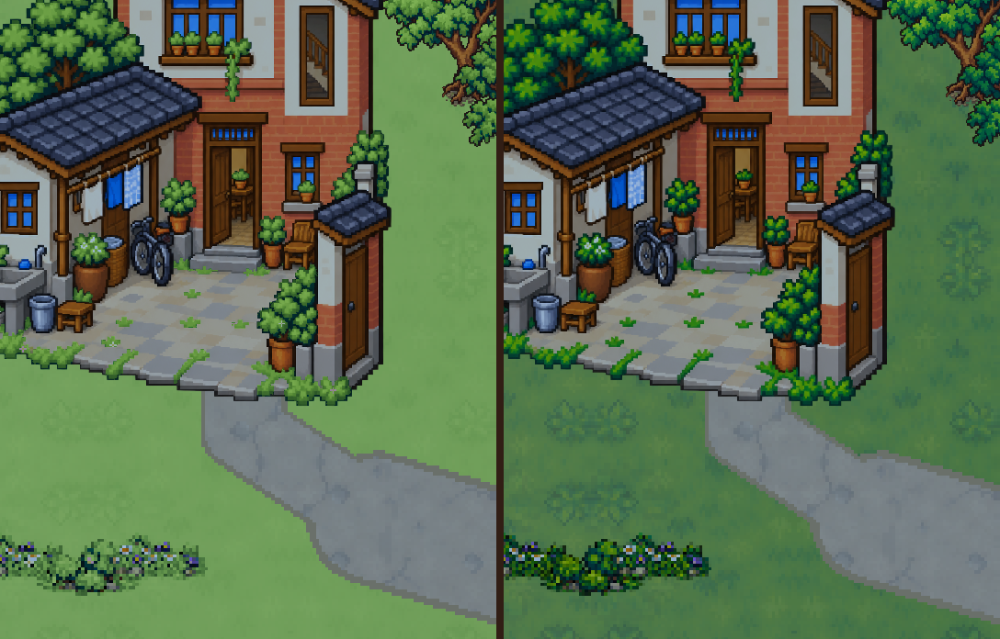

# N3 春季最小补强，待 C1 核图

2026-10-14。已查看C3 `最终-7d87d81` 的019春、020夏、021秋真实窗口图及当前`world.gd`季节材质：原春色只轻微提亮，雨天下区别弱。此包只改**village春季植物材质**，不重画村庄、不改建筑/路网/玩法/天气/篮子。

**唯一接口：`C2春季接入-v1.json`。** 复制接口指定shader与50张控制遮罩，原PNG保持。C4本波完成后待命，N3未判过。

仅一组门前同机位：**左=补强春季，右=现有夏季**。

这是从现有村景资产独立合成的材质预览，按020对应玩家位置推得镜头[1880,3511]、scale1.15、540×696实际世界区、13时雨天调色；未修改C3截图，没有人物/HUD/运动雨滴，不冒充实机截图。

## 范围与接口

- 草与烘焙田间植物用暖嫩绿阶；树/庭院叶片用另一阶嫩叶色，竹丛只混入58%、其余94%，保留原明暗轮廓。新23株树竹灌木、旧庭院、果园、六块田共用该规则，避免新旧断色。
- 遮罩R限定植物；G/B只在既有低庭院、18处花带和果树内编码少量粉/米白花瓣与黄心（全村182个小花点），不额外铺路或占种田区。仅春季显示。
- 主路/入户路/田间路、河道、边沟、池水中心明确排除；向日葵人家的三片青瓦屋顶单独排除。透明光晕不改；运行时再按原图绿色与alpha判定，避免低分辨率遮罩扩到墙面/路面。
- `texture_bindings`给原图SHA、遮罩文件/目标、尺寸、SHA与层类型；`prop_bindings`逐个对应50个原prop及原`plant_kind`。背景绑定ground遮罩、layer0；叶片layer1、常绿竹layer2。不能让房屋继续共享背景材质，按原图+plant_kind缓存独立材质，并纳入现有season/rain更新数组。
- 仅村庄启用`spring_mask_enabled`。未找到遮罩用黑遮罩，不能退回整图染色。其他户外维持原接口；夏季不进入新分支，秋/冬/雨公式与原实现一致，保留当前effects_enabled、天气和光照参数。无新增节点、位置、碰撞或导航。

## 成本与未验项

50张1/3尺寸控制遮罩合计约**151 KB文件、22.8 MiB RGBA纹理估算**；春季多1次遮罩采样，**0新增场景节点**，没有第二套整村底图。实际GPU格式/性能待接入测量。

`本波静态核对.json`确认50项源图哈希未变、遮罩哈希一致、花点只在植物掩区、秋冬分支与原式相同、雨式保留，h7未掩像素及alpha与源图完全一致。shader编译及真实季节/性能未测，不以静态记录判N3。

C3新田块同机位组在交付时尚未看到；现有六块田已包含在ground遮罩中。若其图定位出具体问题，再作必要修正。C1核图后C2按唯一接口接入，C3实拍春夏田块及门前，并复核已认可夏色和冬霜。

本波开工实查剩71%、结束68%；30%冻结/15%强停保持。只写设计目录，无生产代码/Git/游戏窗口操作。
