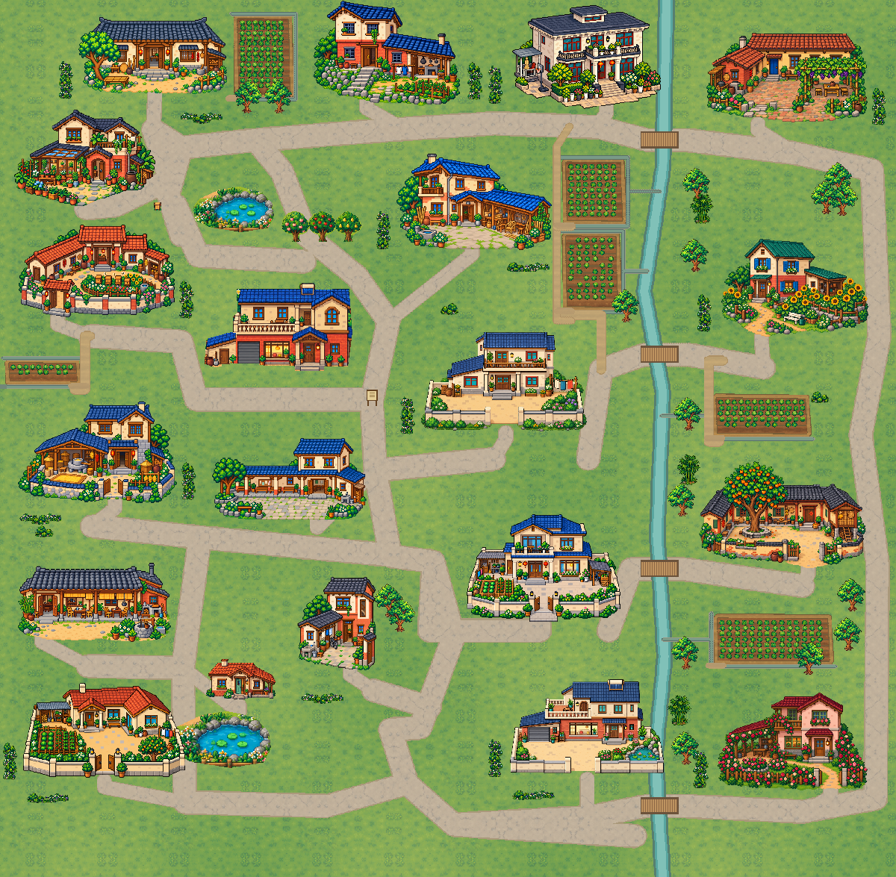
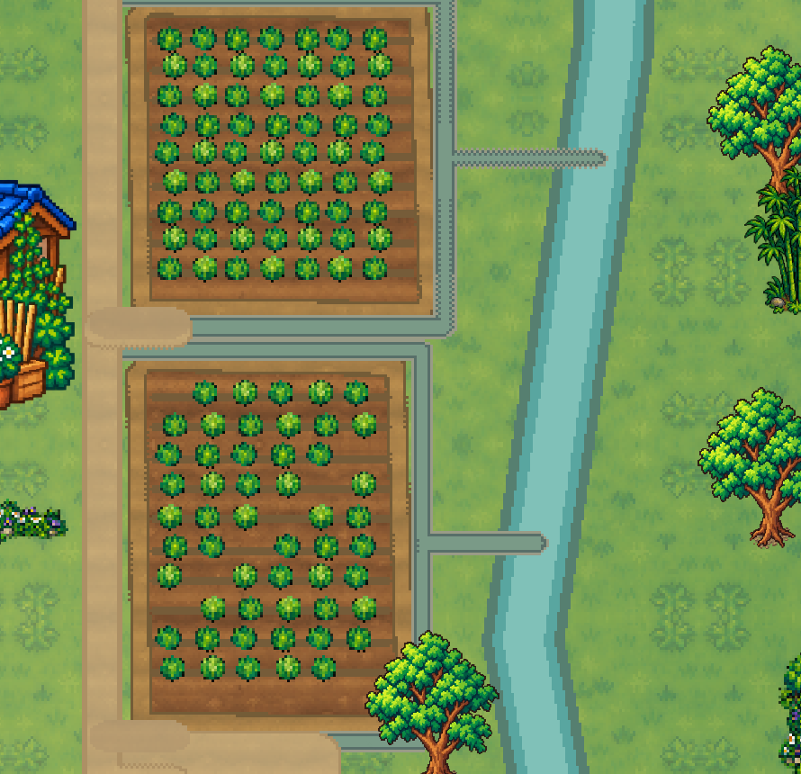

# C4 完整村外 v2 交付，待 C1 核图

2026-10-14，2期当前小阶段。**完整美术已由C4编排、合成、看图修正；供C1静态验收后C2按精确接口接入。N1～N5实机未判过。** 开工实查99%，本波结束实查91%，普通使用可用；按30%冻结/15%强停规则执行。未改生产godot/Git，未控制C3窗口，未新增生成图或重画房屋/阿鱼家素材。

## 看图入口

同机位东田对照，裁切仍为世界[2870,850,890,860]：

另有`河岸田沟近景-v2.png`、`磨坊院路绿化-v2.png`、`北巷长田与路口-v2.png`。都是C4素材场景合成，非游戏实测截图。

## 五项问题对应修正

| C1 v1问题 | C4 v2实际处理 |
|---|---|
| 同18株小菜畦散铺 | 6块成片田：305×430、325×340、300×405、510×215、625×255、390×125；行数13/9/10/5/7/2，密植/稀植/混合排布，单株取现有菜行绿像素，不复制整张带框18株田 |
| 田埂沟是浮横条 | 沿每块实际田边一整条土埂，连续沟接实际河道或小渗水坑，转角统一连接；5条田间接路，两块东田共用巷路，入口做实际通行口 |
| 果树压水/旧院景残片 | 替换村外`land_`/`wildtree`散铺层；新增23个干净树/竹/低灌木物件，20处仅根部实体；根中心到河中心最小114.2px，20户原房屋和原果园保留 |
| 旧菜垄跨主路/底部占位块 | 重新输出完整4800×4700原生地面，原18条主路/原门连线坐标保留，只有组织好的田区和通路，无旧菜垄/静态占位色块；动态玩家区留空 |
| 门旁绿化零碎 | 18处相连低花/灌木带，门中线和操作点留白；其余已有庭院保留，不为凑数量覆盖通路。预览发现的方块绿底与孤立点已去掉 |

结构、比例、图层和季节沿当前素材：人物84px，粗像素nearest，草土/田路同一暖色系；主路、田间小路、田块、河渠、河岸组团、房屋庭院在同一世界坐标合成。低田埂/菜/花可走，树冠不当整块碰撞。

## C2 只需机械接入

**唯一接口：`C2精确导入-v2.json`。**

1. 拷`ground-c4-v2.png`到接口指定背景路径，nearest；低菜/埂/沟/花园已在地面内，不再叠旧田块或重绘。
2. 拷`assets/`23张实际输出透明物件，使用接口`exact_new_props`原坐标/脚点；删除旧前缀，不修改本次布局。现有建筑/果园/公用物件保持当前生产记录，不把旧快照倒灌成生产配置。
3. 只移除旧`landscape_obstacles`对应根框，再加接口20个根框；原房屋、水、门、NPC、热点、出生和存档不改。更新`village.json`及`rooms.json.rooms.village`，按现有流程只烘village导航。
4. 保留现有季节/天气逻辑。任何位置、层级或拼接问题回坐标给C4修图，不再运行旧素材生成脚本重新决定景观。

`完整美术布局-v2.json`记录田边折线、排水、连接路、庭院和树群；`本波静态核对-v2.json`及接口包含尺寸/源文件/锚点/实体边界/哈希。哈希只用于确认接入同一素材，不当N项运行证据。独立无窗口原生渲染在设计目录完成，原图只读；导出环境数据目录/证书提示未阻止图片生成，最终无脚本错误，源PNG可读。

C1批准前不标“美术已通过”，C2接入后由C3正常实走N1/N2、春夏秋冬及天气等增量验收。当前只交本波完整美术，未宣称2期或Claude第1轮最终通过。
