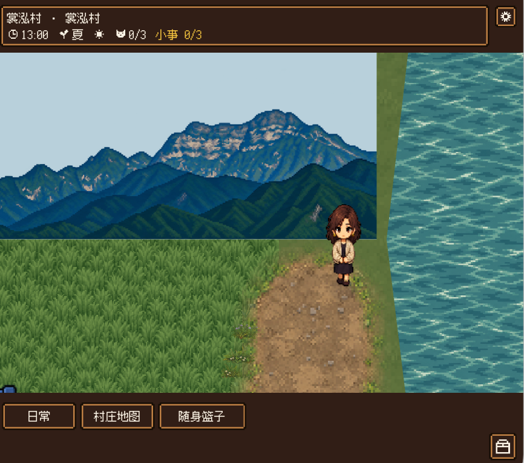
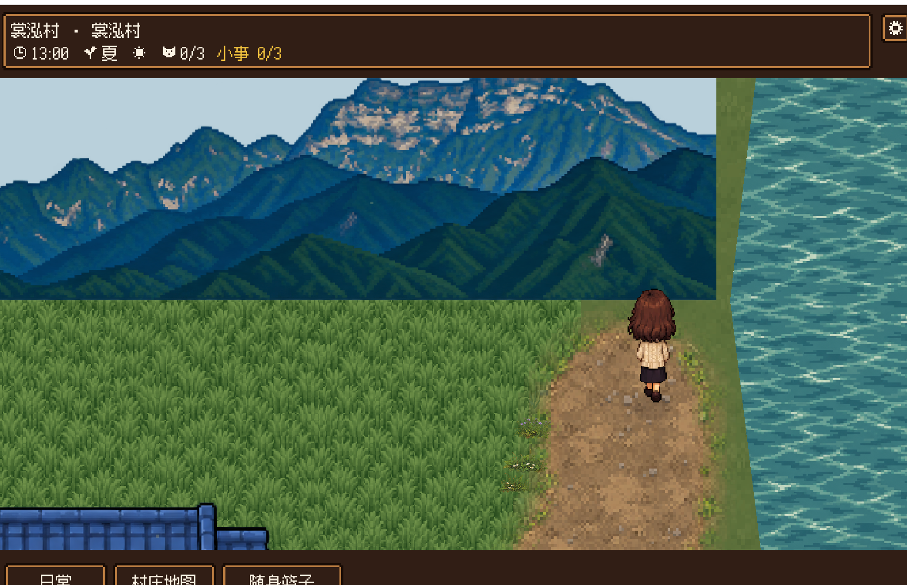

# 请先审查裳泓村，不改游戏

审查私有仓库 `bardayu-cpu/changhong-village` 的 `village-deep-1010` 分支。游戏实现基线是 `1603f8dbc216534432acc4a810659dbdeb46f14e`；后续两次资料提交只增加本指令和四份审查证据，共五个文件，没有修复游戏。10 月 26 日重开的是同一份未修复候选，用户已看到游戏并转向，再次明确判定整村画面失败。当前不得报告达到 90 分。

先并排打开下面的认可参考与两张真实失败图。参考图不等于该图内每栋房屋、布局都获准替换正式成果；冻结要求仍须遵守。

| 用户认可的风格参考 | 首次真实失败图 | 10 月 26 日再次试玩：同一未修复候选 |
| --- | --- | --- |
|  |  |  |

失败记录见同目录 `失败依据.json`。失败图对应村庄玩家检查点 `[4616,568]`，摄像机中心没有单独记录；启动点 `[3544,1960]` 不是失败图位置。当前试玩是有缺陷候选，不能当作已验收成品。

只先读这三份任务书及其引用的冻结房屋、人物协议，不重读无关历史：

- `给Astra任务书/第1轮返工验收-Claude-1025.md`
- `给Astra任务书/村景重做-宁静稻田峨眉远山.md`
- `给Astra任务书/童年支线与人物重画.md`

请按以下顺序审查：

1. **先查整村画面硬失败。** 远山底边与右边矩形硬截，像贴在地面的海报；右侧河面像竖直水墙，岸线与视角不一致；道路、草、田、水岸、远山的比例、像素密度、深度层次与拼接断裂。再次试玩图更清楚显示了完整山图底边，以及正面远山与俯视地面、河面之间缺失的空间关系。逐项区分绘图本身与引擎裁切、排序、相机、材质接入的责任，并核对峨眉山剪影、河在村界、无桥等约束。每项追到实际来源 → 导入处理 → 已激活资源 → 运行画面，不能凭原图好看、文件存在、数量齐全或脚本通过判整村合格。查明这些缺陷为何未在 C1/C3 验收链路中被有效拦截：核实检查镜头、结论与派单，区分已标失败、允许打开测试、局部通过和整村通过，指出遗漏及应补的阻断步骤。
2. **查是否违背定稿。** 核对是否乱画、把阿鱼家的专属造型复用给别人、擅改冻结房屋或人物；哪些漂亮原图没有真正落地，哪些候选仍未启用。保留已合格的阿鱼一家、房屋与布局，列出可继续使用的明确范围，避免整套重画循环。参考图不能覆盖任务书里的冻结限制。
3. **再核玩法与交付。** 按 8 项收尾、G/H、S1–S4、R 及人物协议逐项核证。重点欠项包括：14 户物件前后图、老屋闭门图、树组、九户室内未正式激活、货郎接近后身体重叠与真实点击待验、S3 两次真实鼠标拖拽失败、手机缺 Web 模板/预设/可用包、声音实听与完整流程欠验。h6 第二次 13 点站姿和 19 点真实坐姿的标签窄验已过，不能与首轮失败混写，也不能扩大成全部人物/交互通过。C3 制作的自然弯路测试属于作者自测；C2 接入后由 C3 做的图面复验才是独立复验。

重现时必须说明正式工程与候选的区别。`godot/ayu_home/v4` 是正式实现；`候选/自然路肩样板-1025` 是第一层道路材质候选；`候选/姓名牌随坐姿-1025` 是叠加其上的四源码标签补丁。正式村景并未因标签代码更新就整体切换成新候选。核对各 `bundle.json`，在新建隔离目录和隔离存档中使用已提交的 `preview_patch.py` 等入口；若缺依赖或首次导入未完成，记录缺项，不引用仓库没有的临时 `测试数据/.../工程冻结` 路径冒充可复现。本地既有启动方式只证明候选可启动，不证明已有可双击、重开或手机触控的交付包。上述能力均须实际证据。

正常画面在 13:00、相同季节天气与正常人物比例下，和阿鱼家做同场景条件对照；19:00 真实坐姿另列证据，不能改姿态或比例伪装通过。保留失败原图和复验前后版本。优先把一段包含路、草、岸、水与远山的实际镜头做好，再查全村接缝后铺开，不能继续只调零碎标签。

本次只审查和派任务，不直接返工、不改游戏代码、不重画。报告写入 `给Astra任务书/整村视觉与交付复审-Claude-1026.md`，包含：

1. 通过／失败／欠验证据表，列代码或激活资源路径、运行图、测试方式及证明边界。
2. 诚实评分、90 分硬缺口，区分画面、可玩性和可交付性。
3. 按阻塞程度排序的最小修复清单，标清素材问题与接入问题。
4. 给 C1 的具体派单：C2 接入、C4 绘图、C3 独立复验；每项写可执行验收步骤和停止条件。
5. 应冻结保留的成果及依据，避免重画循环。

旧文档的 15% 停线已作废，当前为 10% 硬停。本轮额度恢复不构成重新开发的授权；此次仅授权打开既有试玩和整理审查交接。
